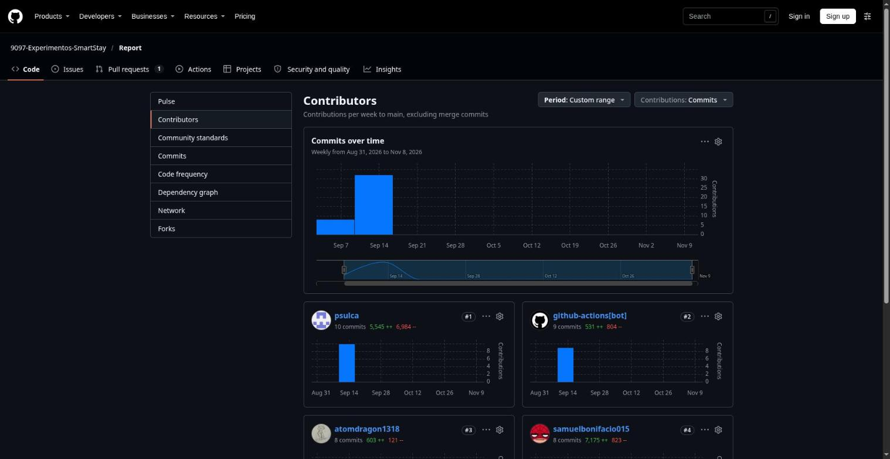

## Registro de Versiones del Informe

El objetivo de esta sección es resumir las modificaciones relevantes que se realizan al informe durante el ciclo de vida del proyecto. Esta sección inicia en una página nueva e incluye un cuadro con la siguiente estructura:

| Versión | Fecha | Autor | Descripción de los Cambios |
| :-----: | :---: | :--- | :--- |
| 1.0 | 05/09/2026 | Samuel Jesus Bonifacio Jaramillo | Inicialización de repositorios |
| 1.1 | 07/09/2026 | Samuel Jesus Bonifacio Jaramillo | Creación de Capitulos I–V, corrección de la tabla de integrantes, correcciones de redacción y actualización de contenidos. |
| 1.2 | 04/10/2026 | SmartStay Team | Creación del Capítulo VI (6.1 Testing Suites & Validation) y del Capítulo VII (7.1 a 7.3 DevOps Practices) con las primeras evidencias de pruebas. |
| 1.3 | 08/10/2026 | SmartStay Team | Actualización del Capítulo VII (7.2 y 7.3) con los diagramas de los pipelines de entrega y despliegue. |
| 1.4 | 09/11/2026 | SmartStay Team | Capítulo VI: 6.2 Static testing & Verification (ESLint, auditoría de dependencias, revisión de pull requests), 6.3 Validation Interviews (diseño) y 6.4 Auditoría de Experiencias de Usuario (estructura). |
| 1.5 | 09/11/2026 | SmartStay Team | Capítulo VII: 7.4 Continuous Monitoring, con resultados de GitHub Actions, disponibilidad y mediciones de Lighthouse. |
| 1.6 | 09/11/2026 | SmartStay Team | Capítulo VIII: 8.1 Experiment Planning, 8.2 Experiment Design, 8.3.1 To-Be User Stories y 8.3.2 To-Be Product Backlog. |
| 1.7 | 09/11/2026 | SmartStay Team | Actualización de Student Outcome (AV2), Project Report Collaboration Insights y 5.2.8 con los reportes de commits por rama. |
| 1.8 | 09/11/2026 | SmartStay Team | Corrección de 6.1 (resultados de pruebas y fragmentos Gherkin) y de 7.1 a 7.3 para que coincidan con los repositorios, workflows y plataformas de despliegue reales. |
| 1.9 | 09/11/2026 | SmartStay Team | Inspección heurística del portal del huésped en 6.3.3, vistas del huésped en 5.2.3 y ajuste del experimento E-02 en el Capítulo VIII. |
| 1.10 | 09/11/2026 | SmartStay Team | Nuevo 5.2.4 Acuerdo de Servicio - SaaS (los apartados siguientes de 5.2 pasan a 5.2.5 a 5.2.8), descripción de despliegue de la landing page en 5.1.4, Student Outcome AV2 completo y bibliografía actualizada. |

### Project Report Collaboration Insights

**Repositorio del informe:** [https://github.com/9097-Experimentos-SmartStay/Report](https://github.com/9097-Experimentos-SmartStay/Report)

El informe se elabora de forma colaborativa en Markdown, con la rama `develop` como base de trabajo, ramas `feature/*` para cada bloque de contenido y *pull requests* hacia `main`. Cada cambio sigue Conventional Commits, y un workflow de GitHub Actions regenera el `README.md` a partir de los archivos de `docs/` en cada integración, de modo que el informe nunca se edita directamente en el archivo generado.

#### Entrega AV1

Se redactaron los Capítulos I a V y se aplicó la estructura exigida por el enunciado. Samuel Bonifacio configuró el repositorio, la estructura de `docs/` y el script `scripts/build_report.py`; Piero Sulca mantuvo el script y la numeración de capítulos; Ítalo Verona y Alejandro Galindo aportaron contenido de los Capítulos II y III. La mayor parte de estos commits se concentró en la semana del 07/09/2026 al 18/09/2026.

#### Entrega AV2

Se añadieron los Capítulos VI, VII y VIII, y se actualizaron el Registro de Versiones, el Student Outcome y esta sección. El Capítulo VI y los apartados 7.1 a 7.3 se redactaron entre el 04/10/2026 y el 08/10/2026 en `develop`; los apartados 6.2 a 6.4, 7.4 y el Capítulo VIII y las actualizaciones de esta entrega se preparan en la rama `feature/av2`.

**Commits del informe por integrante en todas las ramas** (entre paréntesis, los commits desde el 19/09/2026, inicio de AV2):

| Integrante | Commits en `Report` |
| :--- | :---: |
| Bonifacio Jaramillo, Samuel Jesus | 11 (3) |
| Galindo Manuel, Alejandro Manuel | 6 (1) |
| Ponce Perales, Alberto Alejandro | 0 (0) |
| Sulca Sanchez, Piero Angel | 11 (0) |
| Verona Flores, Ítalo Sebastián | 12 (4) |

Los autores de Git se asignaron a cada integrante por su nombre de usuario o correo. Los commits del bot `github-actions[bot]` (15 en total) regeneran el `README.md` y no se atribuyen a ningún integrante. El conteo excluye los commits de fusión.

*Gráfico de contribuciones de GitHub para `Report` entre el 01/09/2026 y el 08/11/2026. GitHub solo cuenta los commits de la rama `main` y excluye los de fusión.*

**Interpretación.** La participación de Alejandro, Ítalo, Piero y Samuel quedó registrada en el repositorio, con picos de actividad en las semanas previas a cada entrega. En esta entrega no figuran commits de Alberto Ponce con su nombre ni su correo institucional en el repositorio del informe, por lo que su aporte debe revisarse y, de corresponder, registrarse mediante commits o un archivo `.mailmap` que unifique sus identidades de Git. La coherencia con el Registro de Versiones se mantiene: cada fila de la tabla de versiones corresponde a commits de las fechas indicadas.
