# Capítulo VI: Product Verification & Validation

## 6.1. Testing Suites & Validation

La estrategia de validación de SmartStay cubre los tres servicios principales: **el backend, la aplicación web y la aplicación móvil.** 

El backend cuenta con pruebas unitarias, de integración y de comportamiento (BDD) automatizadas. La aplicación móvil tiene pruebas unitarias de Flutter y una prueba de integración contra el backend, y la aplicación web, una prueba de integración contra el backend con Vitest y una prueba funcional con Selenium del inicio de sesión. La landing page no tiene pruebas automatizadas.

### 6.1.1. Core Entities Unit Tests.

Las pruebas unitarias verifican las entidades, agregados, objetos de valor y servicios de aplicación de cada contexto delimitado de forma aislada, sin base de datos real. En el backend se organizan en dos proyectos NUnit, y en la aplicación móvil se escriben con `flutter_test`.

#### Backend (ASP.NET Core 9, NUnit)

| Proyecto | Contextos y áreas cubiertas | Pruebas |
|---|---|---:|
| `BackendAwSmartstay.API.UnitTests` | **Bookings:** Domain (`BookingTests`). **Payments:** Application, Domain e Infrastructure (pasarelas manual y simulada de tarjeta, `CardDetails`, `Payment`). | 87 |
| `BackendAwSmartstay.API.Tests` | **Accommodations:** Application (fachadas ACL). **Bookings:** Application, Domain e Infrastructure. **IAM:** Infrastructure. **Profiles:** Application, Compatibility, Domain (Aggregates, Entities, ValueObjects), Infrastructure/Persistence e Interfaces/REST. | 150 |

Ambos proyectos se ejecutaron con `dotnet test` el 9 de noviembre de 2026 y todas las pruebas pasaron (0 fallidas, 0 omitidas). Esta organización permite ubicar cada prueba según el contexto y la responsabilidad del componente: las áreas de dominio corresponden a entidades y reglas de negocio; las de aplicación, a la coordinación de operaciones; y las de infraestructura, a mecanismos como la persistencia. Las secciones de compatibilidad e interfaces del contexto Profiles cubren la lectura de datos previos y los controladores REST.

*Estructura del proyecto de pruebas del backend y ejecución exitosa*


*Prueba de persistencia de Payments*


#### Aplicación móvil (Flutter, `flutter_test`)

La aplicación móvil cuenta con 16 pruebas en tres archivos, ejecutadas con `flutter test` el 9 de noviembre de 2026 (16 aprobadas):

| Archivo | Qué verifica | Pruebas |
|---|---|---:|
| `test/staff_models_test.dart` | Matriz de permisos por rol (recepción, housekeeping, huésped y roles desconocidos), lectura de `BookingResource`, expiración y cancelación de reservas, resolución de reservas por día del calendario, mapa de habitaciones por estado, pagos en efectivo sin número de operación y cálculo de fechas | 9 |
| `test/guest_booking_api_test.dart` | Validación de tarjeta (`CardDetails.parse`), creación de reserva, error del backend al reservar, pago con tarjeta y cancelación rechazada | 6 |
| `test/widget_test.dart` | La aplicación del huésped carga correctamente | 1 |

#### Aplicación web

El frontend web (Vue 3 + Vite) no cuenta aún con una suite de pruebas unitarias automatizadas. Su comunicación con el backend se verifica en la sección 6.1.2 y su verificación funcional en la sección 6.1.4.

### 6.1.2. Core Integration Tests.

Las pruebas de integración verifican que varios componentes funcionan correctamente **juntos**: servicios de aplicación con repositorios, repositorios con Entity Framework, y contextos delimitados que se comunican por sus fachadas ACL. En el backend son 35 pruebas del proyecto `BackendAwSmartstay.API.Tests`, ejecutadas con `dotnet test` el 9 de noviembre de 2026 (35 aprobadas, 0 fallidas).

| Clase de pruebas | Contexto | Qué integra | Pruebas |
|---|---|---|---:|
| `BookingsPersistenceTests` | Bookings | Agregado `Booking` con EF Core: persistencia, estados y reserva con y sin perfil de huésped | 3 |
| `BookingCommandServiceAclIntegrationTests` | Bookings ↔ Profiles | Servicio de comandos con la fachada de perfiles: resuelve el huésped por usuario o correo, o crea la reserva sin perfil si no existe | 6 |
| `ProfilesPersistenceTests` | Profiles | Perfiles de huésped y de staff con EF Core: persistencia, consultas y generador de códigos de empleado | 5 |
| `StaffProfileCommandServiceAclIntegrationTests` | Profiles ↔ Accommodations | Asignación de staff a hoteles validando el hotel por la fachada de alojamiento; rechaza hoteles inexistentes sin persistir | 3 |
| `AccommodationsContextFacadeTests` | Accommodations | Fachada ACL: existencia de hotel, ids inválidos y contrato sin exponer entidades internas | 5 |
| `CrossContextIdentityCompatibilityTests` | IAM ↔ Profiles ↔ Accommodations | Los ids enteros de usuario y de hotel son aceptados entre contextos | 4 |
| `IamSeederTests` | IAM | Alta del administrador de cadena con política de contraseñas; rechaza contraseñas filtradas, cortas, repetitivas, con el correo o comunes | 7 |
| `ProfilesDependencyInjectionTests` | Profiles | Registro de servicios del contexto en el contenedor de dependencias | 1 |
| `ProfilesMySqlConcurrencyIntegrationTests` | Profiles | Generación concurrente de códigos de empleado sobre MySQL 8.0.36 real (contenedor Docker) | 1 |
| **Total** | | | **35** |

Las pruebas cubren tanto caminos felices como caminos de fallo: hotel inexistente, huésped sin perfil, contraseñas rechazadas por política o filtradas, e identificadores no válidos.

*Código de una de las pruebas de integración (`BookingCommandServiceAclIntegrationTests`)*


*Ejecución de las pruebas de integración, resumen por clase*


*Ejecución de las pruebas de integración, detalle de las 35 pruebas*


**Base de datos de las pruebas.** La mayoría de estas pruebas usan Entity Framework en memoria y fachadas o repositorios de prueba para aislar la lógica. La prueba de concurrencia (`ProfilesMySqlConcurrencyIntegrationTests`) se ejecuta contra un **MySQL 8.0.36 real**: diez contextos de EF generan códigos de empleado en paralelo y se verifica que los diez códigos son únicos y siguen el formato `EMP-00000`. En desarrollo local se usa un contenedor Docker de MySQL (`docker-compose.yml`) indicado con la variable `TEST_MYSQL_CONNECTION`; en el CI de GitHub Actions el job `build-and-test` levanta un contenedor de servicio `mysql:8.0.36` y define `REQUIRE_MYSQL_TESTS=true`, de modo que si la base no está disponible la prueba falla en lugar de omitirse.

#### Comunicación frontend ↔ backend

Las pruebas anteriores validan el backend. Para validar también la comunicación entre las aplicaciones cliente y la API, la aplicación web y la aplicación móvil cuentan con una prueba de integración que usa **su propia capa de acceso a la API contra un backend real** (API de ASP.NET Core y MySQL 8 levantados con `docker compose`), sin respuestas simuladas. Ambas recorren el mismo flujo de una cuenta de huésped:

| # | Escenario | Tipo | Resultado esperado |
|---|---|---|---|
| 1 | Registro de una cuenta nueva | Camino feliz | La cuenta se crea con el correo sin verificar |
| 2 | Registro con un correo ya registrado | Camino de fallo | El backend lo rechaza |
| 3 | Inicio de sesión antes de verificar el correo | Camino de fallo | Rechazo con el código `auth.email_not_verified` |
| 4 | Inicio de sesión con contraseña incorrecta | Camino de fallo | Rechazo con estado 401 |
| 5 | Endpoint protegido sin sesión (solo web) | Camino de fallo | Rechazo con estado 401 |
| 6 | Verificación del correo, inicio de sesión y consulta de las reservas del huésped | Camino feliz | Sesión de rol `guest` y lista de reservas vacía |

En modo desarrollo el backend escribe en su registro el enlace de verificación del correo, de modo que la prueba lee el token de `docker logs` y no necesita un buzón real. Ambas pruebas se omiten por sí solas si la URL de la API no es local (`localhost` o `127.0.0.1`), para no crear cuentas en producción.

##### Aplicación web (Vitest + jsdom)

La prueba `tests/integration/auth-flow.integration.spec.js` usa `AuthenticationApi`, los comandos de dominio, el cliente HTTP compartido y `SessionAssembler` de la aplicación web. Se ejecuta con el origen `http://localhost:5173`, por lo que además comprueba que la política CORS del backend permite las llamadas desde el frontend. Se corre con `npm run test:integration`: 6 pruebas aprobadas.

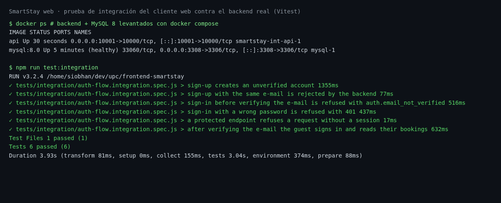

##### Aplicación móvil (flutter_test)

La prueba `test/integration/auth_flow_integration_test.dart` usa el `ApiClient` real de la aplicación (paquete `http`) contra el backend. Solo se simula el almacén seguro de la sesión del dispositivo, que no existe en un test. Se corre con `flutter test test/integration --dart-define=API_BASE_URL=http://127.0.0.1:10000/api/v1`: 5 pruebas aprobadas.

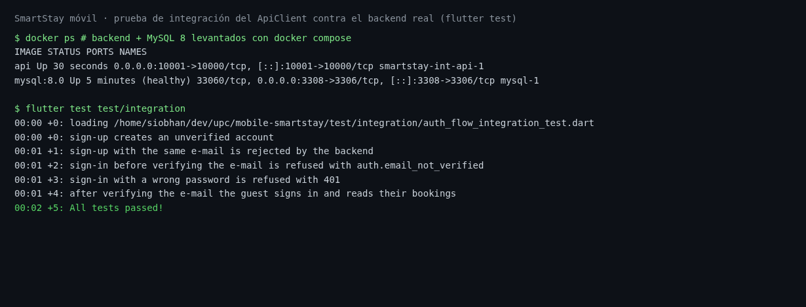

Además, `test/guest_booking_api_test.dart` verifica el contrato del cliente de reservas del móvil con respuestas simuladas del backend: creación de reserva, error devuelto por el backend, pago con tarjeta rechazado y cancelación no aceptada.

### 6.1.3. Core Behavior-Driven Development

Para verificar el comportamiento del software desde la perspectiva del negocio y del usuario final, se implementó una suite de pruebas automatizadas bajo el enfoque **Behavior-Driven Development (BDD)**. Se creó el proyecto dedicado `BackendAwSmartstay.API.BddTests` integrado a la solución backend sobre **.NET 9**, utilizando **Reqnroll (v2.3.0)** sobre **NUnit (v4.2.2)**, **FluentAssertions (v7.2.0)** y aislamiento de persistencia en memoria mediante `Microsoft.EntityFrameworkCore.InMemory`.

#### 1. Cobertura de User Stories y Escenarios BDD

Se implementaron **29 escenarios** en sintaxis Gherkin, distribuidos en **9 User Stories** del Product Backlog. Cada escenario está etiquetado según el tipo de camino que verifica: `@happy-path` para el flujo esperado, y `@negative`, `@validation`, `@boundary` o `@security` para los caminos alternos (rechazos, validaciones, casos límite y seguridad).

| User Story | Título | Contexto | Escenarios | Camino feliz | Caminos alternos |
| --- | --- | --- | ---: | ---: | ---: |
| **US-01** | Registro de usuario | IAM | 3 | 1 | 2 |
| **US-02** | Inicio de sesión seguro | IAM | 3 | 1 | 2 |
| **US-03** | Gestión de perfiles y roles | IAM / Profiles | 3 | 2 | 1 |
| **US-04** | Recuperación de contraseña | IAM | 3 | 2 | 1 |
| **US-52** | Autenticación de dos factores para staff | IAM | 3 | 2 | 1 |
| **US-06** | Gestión de habitaciones y estados | Accommodations | 3 | 2 | 1 |
| **US-53** | Configuración de hotel y habitaciones | Accommodations | 3 | 1 | 2 |
| **US-07** | Gestión centralizada de reservas | Bookings | 3 | 3 | 0 |
| **US-51** | Reserva de habitación por huésped | Bookings | 5 | 1 | 4 |
| **Total** | **9 historias** | **3 contextos** | **29** | **15** | **14** |

#### 2. Especificación de Escenarios Gherkin (`.feature`)

Los archivos `.feature` capturan los criterios de aceptación en lenguaje de negocio mediante la estructura `Given-When-Then`, con el texto de los pasos en español. A continuación se muestran dos de los nueve archivos, tal como están en el repositorio.

Las fechas de los escenarios de reservas se escriben de forma relativa a la fecha de ejecución (`hoy+30` equivale a treinta días después de hoy, y `hoy-3` a tres días antes), para que las pruebas no dejen de pasar cuando el calendario avanza.

##### Archivo: `US51_ReservaHabitacionPorHuesped.feature` (Contexto Bookings)

```gherkin
@US-51
@Bookings
Feature: Reserva de habitación por huésped

  Como huésped del hotel SmartStay
  Quiero reservar una habitación disponible para mis fechas de estadía
  Para asegurar mi alojamiento de forma confiable

  @US-51
  @happy-path
  Scenario: Registrar una reserva para una habitación disponible
    Given que existe un hotel registrado y operativo
    And existe una habitación "101" de tipo "Double" disponible con precio por noche de 150.00 soles
    And existe un huésped registrado con correo "juan.perez@smartstay.pe" y nombre "Juan Perez"
    When el huésped solicita registrar una reserva desde "hoy+30" hasta "hoy+34"
    Then la reserva debe crearse exitosamente
    And el estado inicial de la reserva debe ser "Pending"
    And la reserva debe contener un código de reserva generado
    And la reserva debe estar asociada a la habitación "101"

  @US-51
  @negative
  Scenario: Rechazar una reserva que se superpone con otra reserva existente
    Given que existe un hotel registrado y operativo
    And existe una habitación "102" de tipo "Single" disponible con precio por noche de 100.00 soles
    And existe una reserva activa para la habitación "102" del "hoy+39" al "hoy+44"
    When otro huésped intenta registrar una reserva para la habitación "102" del "hoy+41" al "hoy+43"
    Then la solicitud de reserva debe ser rechazada indicando que la habitación no está disponible

  @US-51
  @validation
  Scenario: Rechazar una reserva cuya fecha de salida no sea posterior a la fecha de entrada
    Given que existe un hotel registrado y operativo
    And existe una habitación "103" de tipo "Suite" disponible con precio por noche de 250.00 soles
    And existe un huésped registrado con correo "maria.lopez@smartstay.pe" y nombre "Maria Lopez"
    When el huésped solicita registrar una reserva desde "hoy+39" hasta "hoy+37"
    Then la solicitud de reserva debe ser rechazada por rango de fechas inválido

  @US-51
  @boundary
  Scenario: Permitir una reserva que comienza el mismo día en que termina la reserva anterior
    Given que existe un hotel registrado y operativo
    And existe una habitación "104" de tipo "Double" disponible con precio por noche de 180.00 soles
    And existe una reserva activa para la habitación "104" del "hoy+30" al "hoy+34"
    When un nuevo huésped solicita registrar una reserva para la habitación "104" del "hoy+34" al "hoy+39"
    Then la reserva debe crearse exitosamente
    And el estado inicial de la reserva debe ser "Pending"

  @US-51
  @validation
  @negative
  Scenario: Rechazar una reserva cuya fecha de entrada ya pasó
    Given que existe un hotel registrado y operativo
    And existe una habitación "105" de tipo "Single" disponible con precio por noche de 100.00 soles
    And existe un huésped registrado con correo "carlos.ruiz@smartstay.pe" y nombre "Carlos Ruiz"
    When el huésped solicita registrar una reserva desde "hoy-3" hasta "hoy-1"
    Then la solicitud de reserva debe ser rechazada porque la fecha de entrada ya pasó
```

##### Archivo: `US06_GestionHabitacionesYEstados.feature` (Contexto Accommodations)

```gherkin
@US-06
@Accommodations
Feature: Gestión de habitaciones y estados

  Como personal del hotel (Staff / Housekeeping / Maintenance)
  Quiero actualizar el estado operativo de una habitación
  Para reflejar con precisión su disponibilidad y control en el sistema

  @US-06
  @happy-path
  Scenario: Cambiar el estado de una habitación de Disponible a Mantenimiento
    Given que existe una habitación "301" en estado "Available"
    When el personal solicita cambiar el estado de la habitación "301" a "Maintenance"
    Then el estado de la habitación "301" debe actualizarse a "Maintenance"

  @US-06
  @happy-path
  Scenario: Cambiar el estado de una habitación de Limpieza a Disponible
    Given que existe una habitación "302" en estado "Cleaning"
    When el personal solicita cambiar el estado de la habitación "302" a "Available"
    Then el estado de la habitación "302" debe actualizarse a "Available"

  @US-06
  @negative
  Scenario: Rechazar una transición de estado no permitida para la habitación
    Given que existe una habitación "303" en estado "Occupied"
    When el personal solicita cambiar el estado de la habitación "303" a "Available"
    Then la solicitud de cambio de estado debe ser rechazada por transición no permitida
```

#### 3. Implementación de Step Definitions en C# (.NET 9)

La vinculación entre los pasos Gherkin y los servicios del backend se implementa con clases decoradas con el atributo `[Binding]` de Reqnroll. Cada clase usa los servicios de aplicación reales del contexto, con repositorios y fachadas de prueba. A continuación se muestran fragmentos de `US51_ReservaHabitacionStepDefinitions.cs`.

```csharp
[Given(@"existe una habitación ""(.*)"" de tipo ""(.*)"" disponible con precio por noche de (.*) soles")]
public void GivenExisteUnaHabitacionDeTipoDisponibleConPrecioPorNocheDeSoles(string number, string type, decimal price)
{
    _roomNumber = number;
    _roomId = int.Parse(number);
    _roomType = type;
    _roomPrice = price;
}

[When(@"el huésped solicita registrar una reserva desde ""(.*)"" hasta ""(.*)""")]
public async Task WhenElHuespedSolicitaRegistrarUnaReservaDesdeHasta(string checkIn, string checkOut)
{
    try
    {
        var service = CreateService();
        var command = new CreateBookingCommand(
            Requester: BookingRequester.Guest(_guestUserId, _guestEmail),
            RoomId: _roomId,
            GuestName: _guestName,
            GuestEmail: _guestEmail,
            CheckInDate: RelativeDates.Parse(checkIn),
            CheckOutDate: RelativeDates.Parse(checkOut),
            UserId: _guestUserId);

        _createdBooking = await service.Handle(command);
    }
    catch (Exception ex)
    {
        _caughtException = ex;
    }
}

[Then(@"la solicitud de reserva debe ser rechazada porque la fecha de entrada ya pasó")]
public void ThenLaSolicitudDeReservaDebeSerRechazadaPorqueLaFechaDeEntradaYaPaso()
{
    _caughtException.Should().BeOfType<DomainValidationException>()
        .Which.Code.Should().Be(BookingErrorCodes.CheckInInPast);
    _createdBooking.Should().BeNull();
}
```

El helper `RelativeDates` interpreta las fechas relativas de los escenarios:

```csharp
/// <summary>Parses ISO dates or <c>hoy+N</c> / <c>hoy-N</c> (days from today) so scenarios never go stale.</summary>
public static class RelativeDates
{
    private const string Today = "hoy";

    public static DateTime Parse(string text)
    {
        var value = text.Trim();
        if (value.StartsWith(Today, StringComparison.OrdinalIgnoreCase) && value.Length > Today.Length
            && value[Today.Length] is '+' or '-')
        {
            var days = int.Parse(value[Today.Length..], System.Globalization.CultureInfo.InvariantCulture);
            return DateTime.UtcNow.Date.AddDays(days);
        }

        return DateTime.Parse(value, System.Globalization.CultureInfo.InvariantCulture);
    }
}
```

#### 4. Resultados de Ejecución

El 9 de noviembre de 2026 se ejecutó `dotnet test` sobre la solución completa, con un contenedor de MySQL 8.0.36 para la prueba de concurrencia. Pasaron las 266 pruebas de las tres suites, sin fallos ni omisiones:

| Suite de pruebas | Framework | Tipo de prueba | Total | Aprobadas | Fallidas |
| --- | --- | --- | ---: | ---: | ---: |
| `BackendAwSmartstay.API.UnitTests` | NUnit | Unitarias de dominio y aplicación (Bookings y Payments) | 87 | 87 | 0 |
| `BackendAwSmartstay.API.Tests` | NUnit | Unitarias e integración (Accommodations, Bookings, IAM y Profiles) | 150 | 150 | 0 |
| `BackendAwSmartstay.API.BddTests` | Reqnroll + NUnit | Comportamiento (BDD / Gherkin) | 29 | 29 | 0 |
| **Total** | | | **266** | **266** | **0** |


### 6.1.4. Core System Tests

Se ejecutó una prueba funcional automatizada con Selenium sobre el formulario de inicio de sesión del frontend. Se utilizó Chrome visible y la instancia local del frontend en `http://localhost:5173/login`. El caso dejó vacíos el correo electrónico y la contraseña y trató de enviar el formulario.

| Aplicación | Caso | Resultado esperado | Resultado observado | Estado |
|---|---|---|---|---|
| Frontend web | Enviar el inicio de sesión con ambos campos vacíos | Impedir el envío y mostrar una validación en cada campo obligatorio | La ruta se mantuvo en `/login` y aparecieron dos mensajes «Este campo es obligatorio.» | Aprobado |
| Backend | Pruebas del controlador de staff (`StaffControllerTests`, 14 pruebas en `BackendAwSmartstay.API.Tests`) | El controlador de staff responde correctamente a los casos de prueba | Superadas en la ejecución de CI del 07/10/2026 | Aprobado |
| Mobile | Pruebas de Flutter de los modelos de staff, del cliente de reservas del huésped y de la plantilla de widget (`staff_models_test.dart`, `guest_booking_api_test.dart` y `widget_test.dart`, 16 casos) | Los modelos, los roles y las llamadas a la API de reservas se comportan según lo esperado | Sin ejecución registrada: el repositorio `mobile` no tiene pipeline de CI y las pruebas no se ejecutaron en este avance | Pendiente |

Esta ejecución solo confirma la validación de campos vacíos en ese formulario. No verifica autenticación con credenciales, permisos por rol, conexión con el backend, ni otros flujos de la aplicación web. No se guardó una captura ni un reporte de Selenium.

Para el backend, se validó el comportamiento del controlador de staff con datos de prueba.

Por ejemplo, la prueba `StaffControllerTest` verifica el comportamiento del controlador de staff con datos de prueba.


En el frontend, se validó el login/registro con campos de prueba y los resultados fueron los esperados.


## 6.2. Static testing & Verification

La verificación estática revisa el código sin ejecutarlo. En SmartStay se aplicó sobre los cuatro repositorios de la solución (`backend`, `frontend`, `mobile` y `landing-page`) en dos frentes: el cumplimiento de estándares de codificación y la calidad y seguridad del código y de sus dependencias. Las mediciones de esta sección se ejecutaron el **09/11/2026** sobre la rama `main` de los repositorios JavaScript y sobre `develop` en el backend, que es donde reside su pipeline de CI, y se indica de forma explícita cuando una verificación está definida en el pipeline pero no pudo ejecutarse en el equipo donde se redactó este informe.

### 6.2.1. Static Code Analysis

#### 6.2.1.1. Coding standard & Code conventions

El equipo definió en el apartado 5.1.3 las convenciones de codificación por lenguaje. Para comprobar que el código las cumple se asignó una herramienta a cada repositorio:

| Repositorio | Lenguaje | Herramienta de verificación | Configuración | Dónde se ejecuta |
| :--- | :--- | :--- | :--- | :--- |
| `backend` | C# (.NET 9) | `dotnet format --verify-no-changes` | Reglas de formato por defecto del SDK de .NET; `Nullable` habilitado en el proyecto | Job **Lint** de `ci-backend.yml` en cada *push* y *pull request* |
| `frontend` | JavaScript y Vue 3 | ESLint 8.57 con `plugin:vue/vue3-essential` | `.eslintrc.cjs` y script `npm run lint:ci` | Workflow `ci.yml` propuesto en la rama `feature/av2-ci` (pendiente de fusión) y ejecución local |
| `mobile` | Dart (Flutter) | `flutter analyze` con `flutter_lints` 6.0 | `analysis_options.yaml` | Workflow `ci.yml` propuesto en la rama `feature/av2-ci` (pendiente de fusión) |
| `landing-page` | HTML, CSS y JavaScript | Ninguna | No aplica | No aplica |

**Resultado en el frontend web.** El script `lint` que existía en `package.json` no podía ejecutarse, porque ESLint no figuraba entre las dependencias ni había un archivo de configuración. El equipo agregó ESLint 8.57.1, `eslint-plugin-vue` 9.33.0, el archivo `.eslintrc.cjs` y el script `lint:ci`, que verifica sin modificar los archivos (el script `lint` anterior usa `--fix`). La primera ejecución sobre el código del repositorio analizó **205 archivos** y reportó **25 errores y 0 advertencias**.

```text
$ npm run lint:ci
205 archivos analizados · 25 errores · 0 advertencias
```

| Regla de ESLint | Errores | Archivos principales | Interpretación |
| :--- | :---: | :--- | :--- |
| `vue/no-mutating-props` | 15 | `HotelForm.vue` (9), `RoomForm.vue` (6) | Los formularios modifican directamente una *prop* recibida del componente padre. Rompe el flujo de datos de un solo sentido de Vue y debe resolverse con `v-model` sobre una copia local o con eventos `update:`. |
| `no-unused-vars` | 9 | `problem-details.js` (5), `GuestHotels.vue`, `search-availability.query.js`, `booking.entity.js`, `mfa.assembler.js` | Variables o importaciones sin uso. No afectan el comportamiento, pero aumentan el ruido del código. |
| `no-useless-escape` | 1 | `account-rules.js` | Escape innecesario dentro de una expresión regular de validación de contraseña. |

Para este avance se prepararon, sin integrar todavía, las correcciones de 10 de los 25 errores: se retiraron cuatro importaciones usadas solo en comentarios de tipos, se eliminó un escape innecesario en la expresión regular de nombres, se configuró `ignoreRestSiblings` para el patrón que descarta miembros conocidos de la respuesta de error y se documentó el parámetro de la función de detalle de hotel que aún no se usa. Quedan 15 errores de `vue/no-mutating-props`, que requieren refactorizar los dos formularios. El paso de lint del workflow propuesto para el frontend está configurado con `continue-on-error`. Mientras estos 25 errores estén abiertos, el pipeline los muestra en cada ejecución sin bloquear la integración. Una vez corregidos, la opción se retira para que el lint sea obligatorio.

**Resultado en el backend, el móvil y la landing page.**

- En el **backend**, la verificación de formato forma parte del job *Lint* de `ci-backend.yml`, y el commit `09c2fae` (`style: apply dotnet format whitespace rules`) normalizó el código del repositorio para que el job pasara. Además, el job de compilación usa `--warnaserror`, de modo que cualquier advertencia del compilador detiene el pipeline.
- En la aplicación **móvil**, `analysis_options.yaml` incluye el conjunto `flutter_lints` y solo desactiva la regla `prefer_const_constructors`.
- En la **landing page** no existe ningún linter ni formateador configurado. Se registra como una brecha de verificación y se propone incorporar ESLint con la misma configuración base del frontend.

> **Limitación de esta medición:** el equipo donde se redactó el informe no tiene instalados el SDK de .NET ni el de Flutter, por lo que `dotnet format` y `flutter analyze` no se ejecutaron localmente en esta ocasión. Su resultado queda en el historial de GitHub Actions de cada repositorio, y el de ESLint es el único presentado con números propios.

#### 6.2.1.2. Code Quality & Code Security

La calidad y la seguridad se revisaron en tres niveles: seguridad de las dependencias, higiene de los secretos y calidad estructural del código.

**Seguridad de las dependencias.** Se ejecutó `npm audit` el 09/11/2026 sobre los dos repositorios JavaScript:

| Repositorio | Dependencias analizadas | Vulnerabilidades altas | Vulnerabilidades moderadas | Vulnerabilidades críticas | Corrección disponible |
| :--- | :---: | :---: | :---: | :---: | :---: |
| `frontend` | 288 | 18 | 1 | 0 | Sí, para todas |
| `landing-page` | 79 | 2 | 0 | 0 | Sí, para todas |

En el frontend, los paquetes afectados incluyen `axios`, `follow-redirects`, `form-data`, `@vue/server-renderer` y la familia `@intlify`. En la landing page, `vite` y `source-map-js`. Ninguna es crítica y todas tienen versión corregida. Se ejecutó `npm audit fix` en ambos repositorios, sin integrar todavía: el resultado fue **0 vulnerabilidades** en el frontend y en la landing page, y `npm run build` sigue compilando en los dos.

En el **backend** el control ya está automatizado: el job *Dependency audit* de `ci-backend.yml` ejecuta `dotnet list package --vulnerable --include-transitive` y falla si encuentra paquetes vulnerables. El commit `f875916` (`fix(deps): patch vulnerable packages and drop unused sqlite provider`) corrigió los paquetes que ese control detectó y eliminó un proveedor de SQLite sin uso.

**Higiene de secretos.** Los repositorios publican únicamente archivos `.env.example` con nombres de variables y sin valores reales, `.env` figura en el `.gitignore` de `backend`, `frontend` y `landing-page` (el de `mobile` no lo ignoraba y se corrigió en el directorio de trabajo, pendiente de integrar), y el `render.yaml` del backend declara los secretos con `sync: false`, de modo que Render los solicita al crear el servicio y no se versionan.

**Calidad estructural.** No se configuró SonarQube ni SonarCloud, porque requieren una cuenta de organización. En su lugar, el equipo se apoyó en controles que no dependen de un servicio externo: tipos anulables habilitados en C#, compilación sin advertencias en CI, análisis de `flutter_lints` y las suites de pruebas automatizadas del backend descritas en 6.1. La incorporación de SonarCloud, con medición de complejidad ciclomática, duplicación y cobertura, queda como mejora recomendada y no se presenta como realizada.

### 6.2.2. Reviews

Las revisiones del equipo se realizan mediante *pull requests* sobre `develop` y `main`, siguiendo GitFlow. La tabla resume el estado real de los *pull requests* de cada repositorio al 09/11/2026, consultado con la API de GitHub:

| Repositorio | Pull requests | Fusionados | Cerrados sin fusionar | Abiertos | Con al menos una revisión registrada |
| :--- | :---: | :---: | :---: | :---: | :---: |
| `backend` | 13 | 12 | 1 | 0 | 1 |
| `frontend` | 6 | 6 | 0 | 0 | 0 |
| `mobile` | 1 | 0 | 0 | 1 | 0 |
| `landing-page` | 4 | 4 | 0 | 0 | 0 |
| `Report` | 2 | 1 | 0 | 1 | 0 |

**Hallazgos de la revisión.**

1. Los *pull requests* se usan de forma consistente para integrar `develop` en `main` (`chore(release): merge develop into main`), pero la revisión entre pares dentro de GitHub es escasa: solo uno de los 26 *pull requests* tiene una revisión registrada. Gran parte de la revisión ocurrió en las reuniones del equipo y no quedó como evidencia en la plataforma.
2. Los controles automáticos sí quedaron como barrera: desde el *pull request* #13 del backend, `render.yaml` usa `autoDeployTrigger: checksPass`, de modo que Render solo despliega a producción después de que los *checks* de CI pasan en `main`.
3. **Acción correctiva acordada:** activar la regla de revisión obligatoria de al menos un integrante en las ramas `develop` y `main` de los cuatro repositorios, para que la revisión entre pares quede registrada en GitHub.

---

<div style="page-break-after: always;"></div>

## 6.3. Validation Interviews

Las entrevistas de validación comprueban con usuarios de los segmentos objetivo si el Landing Page y las aplicaciones permiten completar sus tareas. A diferencia de las entrevistas del Capítulo II, que buscaban entender el problema, estas se realizan con el producto funcionando y miden si las soluciones construidas lo resuelven.

### 6.3.1. Diseño de Entrevistas

**Elementos incluidos en la sesión.** Cada sesión se realiza con el producto desplegado, no con prototipos, para que la evidencia corresponda a lo que el usuario realmente recibirá:

| Elemento | URL |
| :--- | :--- |
| Landing Page | https://smartstay-movildev-landing.vercel.app/ |
| Aplicación web (administrador y huésped) | https://smartstay-movildev-web.vercel.app |
| Aplicación móvil (huésped y staff) | APK de la última versión publicada en el repositorio `mobile` |
| Documentación de la API | https://smartstay-movildev-api.onrender.com/scalar/ |

**Segmento 1: Staff operativo y administradores de hoteles.** Participan de 3 a 5 personas que administren o trabajen en un hotel boutique o pequeño. Los *user flows* a evaluar son:

| # | Tarea | Producto | User Story relacionada |
| :-: | :--- | :--- | :--- |
| 1 | Iniciar sesión como staff con segundo factor de autenticación | Web y móvil | US-02, US-52 |
| 2 | Registrar el hotel y configurar tipos de habitación, habitaciones y precios | Web | US-53 |
| 3 | Cambiar el estado de una habitación a mantenimiento y volverla a disponible | Web | US-06 |
| 4 | Revisar las reservas del día y cancelar una reserva sin pago | Web | US-07 |
| 5 | Crear un usuario de recepción y asignarle su rol | Web | US-03 |
| 6 | Solicitar una demostración desde la landing page | Landing | US-27 |

**Segmento 2: Huéspedes de hoteles boutique.** Participan de 3 a 5 personas que hayan reservado un alojamiento en los últimos doce meses. Los *user flows* a evaluar son:

| # | Tarea | Producto | User Story relacionada |
| :-: | :--- | :--- | :--- |
| 1 | Crear una cuenta y confirmar el correo | Web y móvil | US-01 |
| 2 | Recuperar la contraseña por correo | Web y móvil | US-04 |
| 3 | Buscar una habitación disponible por fechas y reservarla | Web y móvil | US-51 |
| 4 | Pagar la reserva con tarjeta y consultar su estado | Móvil | US-51 |
| 5 | Cancelar una reserva | Móvil | US-07 |
| 6 | Encontrar información de la empresa y testimonios en la landing page | Landing | US-24, US-26, US-28 |

**Guion de la sesión.** Cada sesión dura aproximadamente 30 minutos y se registra en video con el consentimiento expreso del entrevistado:

1. **Apertura (3 min):** el entrevistador explica que se evalúa el producto y no a la persona, y solicita el consentimiento para grabar.
2. **Perfil (3 min):** nombre, edad, distrito, frecuencia de viaje o rol en el hotel, y dispositivos que usa.
3. **Tareas guiadas (15 min):** el entrevistado realiza las tareas de su segmento, pensando en voz alta. El entrevistador no ayuda salvo bloqueo total. En cada tarea se anota si la completó, cuánto tardó y los errores que cometió.
4. **Preguntas de cierre (6 min):** ¿qué fue lo más difícil?, ¿qué esperabas que ocurriera y no ocurrió?, ¿qué cambiarías?, ¿lo usarías en tu día a día?
5. **Cierre (3 min):** el entrevistado califica de 1 a 5 la facilidad de uso y puede añadir comentarios libres.

**Métricas por tarea:** tasa de finalización sin ayuda, tiempo en completarla y número de errores. Los hallazgos se clasifican con la escala de severidad del formato de evaluación heurística de 6.3.3.

### 6.3.2. Registro de Entrevistas

> **Pendiente:** al momento de este avance el equipo no ha realizado las entrevistas de validación con usuarios de los segmentos objetivo, por lo que no se presentan registros. Para cada entrevista realizada se completará la siguiente ficha, con el video grabado, un cuadro del video y un resumen de las apreciaciones del entrevistado.

| Campo | Contenido a registrar |
| :--- | :--- |
| Segmento | Staff operativo / Huésped |
| Entrevistado | Apellidos y nombres, edad y distrito |
| Video | URL del video en Microsoft Stream, minuto de inicio de la entrevista y duración |
| Captura | Cuadro representativo del video |
| Tareas realizadas | Tarea, ¿completada sin ayuda?, tiempo y errores |
| Resumen | Apreciaciones principales del entrevistado sobre las tareas asignadas |

### 6.3.3. Evaluaciones según heurísticas

Como todavía no hay sesiones con usuarios (6.3.2), el equipo realizó una **inspección heurística de experto** de la aplicación web desplegada, con el formato **UX Heuristics & Principles Evaluation** del Anexo D del enunciado. Esta evaluación se hizo el 09/11/2026 con una cuenta de prueba de huésped, en un navegador de escritorio (1568 × 900) y en un ancho móvil de 390 px. No sustituye a las evaluaciones con usuarios de los segmentos objetivo, que se agregarán cuando se realicen las entrevistas.

| | |
| :--- | :--- |
| **CARRERA** | Ingeniería de Software |
| **CURSO** | Diseño de Experimentos de Ingeniería de Software |
| **NRC** | 9097 |
| **PROFESOR** | Julio Manuel Noriega Melendez |
| **AUDITOR** | SmartStay Team (inspección de experto, sin participantes externos) |
| **CLIENTE(S)** | No aplica: no hubo sesión con usuarios |
| **SITE o APP A EVALUAR** | SmartStay Web (portal del huésped): https://smartstay-movildev-web.vercel.app |

**Tareas evaluadas**

1. Revisar el panel de inicio del huésped.
2. Explorar los hoteles y buscar uno por ciudad o nombre.
3. Explorar las habitaciones y filtrarlas por tipo.
4. Abrir el detalle de una habitación.
5. Iniciar la búsqueda de fechas para reservar (sin confirmar la reserva).
6. Consultar «Mis reservas» y «Clima de mi habitación».

**No incluidas en esta versión:** confirmar y pagar una reserva, cancelarla, el panel del administrador y del personal, y la aplicación móvil. No se confirmaron reservas para no crear datos en el entorno de producción.

**Escala de severidad:** 1 = problema superficial; 2 = problema menor; 3 = problema mayor; 4 = problema muy grave.

**Tabla resumen**

| # | Problema | Severidad | Heurística / principio violado |
| :-: | :--- | :-: | :--- |
| 1 | Un hotel de prueba («Hostal Prueba Moyobamba», con precio S/ 0,00 y descripción «Hostal de prueba») aparece en el listado que ve el huésped | 3 | Usability: Correspondencia entre el sistema y el mundo real |
| 2 | Las tarjetas de habitación no indican a qué hotel pertenecen | 3 | Usability: Reconocimiento en lugar de recuerdo |
| 3 | Después de elegir una habitación, el formulario «Reserva una habitación» no muestra cuál fue elegida y vuelve a pedir el hotel | 3 | Usability: Visibilidad del estado del sistema |
| 4 | El login web tiene contraste insuficiente entre texto y fondo, atributos `aria-*` que no coinciden con sus roles y no tiene un elemento `main` | 3 | Inclusive Design: Perceptible y operable con tecnologías de apoyo |
| 5 | El filtro «Filtrar por tipo» muestra el campo vacío y su etiqueta queda debajo del control | 2 | Usability: Consistencia y estándares |
| 6 | El buscador de hoteles solo tiene un *placeholder*; el icono de búsqueda queda separado y sobre el campo, sin etiqueta visible | 2 | Usability: Consistencia y estándares; Inclusive Design: Etiquetas claras |
| 7 | Las habitaciones visibles no tienen foto y solo muestran un icono de imagen; una tarjeta de hotel muestra una captura de documento en lugar de una foto | 2 | Usability: Diseño estético y minimalista |
| 8 | En móvil, el título «Nuestros hoteles» y su subtítulo quedan desplazados respecto del buscador y de las tarjetas | 1 | Usability: Consistencia y estándares |
| 9 | La página de inicio de sesión no tiene `meta description` y su `robots.txt` devuelve la página principal | 2 | Information Architecture: Descubrimiento y rotulado |

**Aspectos positivos observados:** las pantallas vacías («Sin viajes programados», «No tienes reservas activas», «Todavía no tienes una estadía activa») explican qué pasa y ofrecen una acción; el detalle de la habitación muestra la política de cancelación antes de reservar; la navegación superior es coherente entre pantallas y el sitio se adapta al ancho móvil sin desplazamiento horizontal.

**Detalle de los problemas**

**Problema 1 (severidad 3).** *Tarea 2.* El listado de hoteles incluye un registro creado para validar el alta de hoteles. El huésped ve un hotel con precio S/ 0,00 que no puede reservar con sentido. *Recomendación:* ocultar los hoteles de prueba al huésped, por ejemplo con un indicador de visibilidad en el hotel, y limpiar los datos de demostración del entorno de producción.

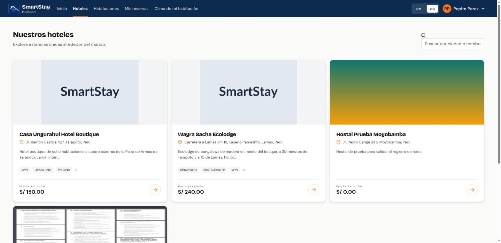

**Problema 2 (severidad 3).** *Tarea 3.* Cada tarjeta muestra tipo, número, descripción, comodidades y precio, pero no el hotel. Con varios hoteles, el huésped no sabe dónde está la habitación 101. *Recomendación:* incluir el nombre del hotel y la ciudad en cada tarjeta y permitir filtrar por hotel.

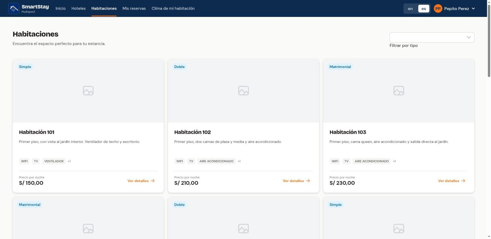

**Problema 3 (severidad 3).** *Tareas 4 y 5.* Desde el detalle de la habitación 101, el botón «Buscar fechas y reservar» lleva a un formulario que pide hotel, llegada y salida, y no repite qué habitación se está reservando. La habitación elegida solo se conserva en la dirección de la página (parámetro `roomId`). *Recomendación:* mostrar un resumen de la habitación elegida (tipo, número, hotel, precio por noche) en la parte superior del formulario.

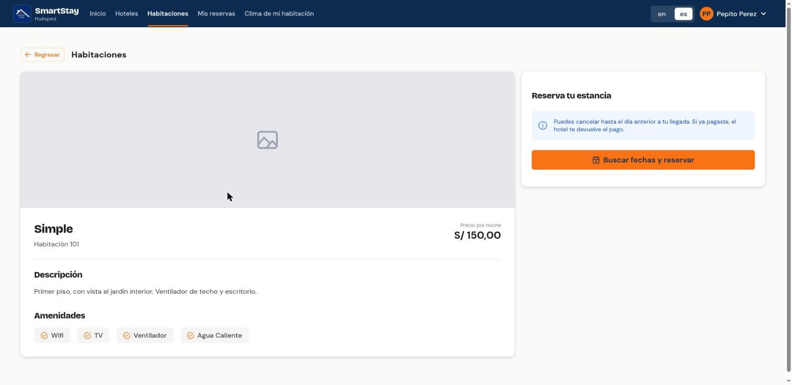

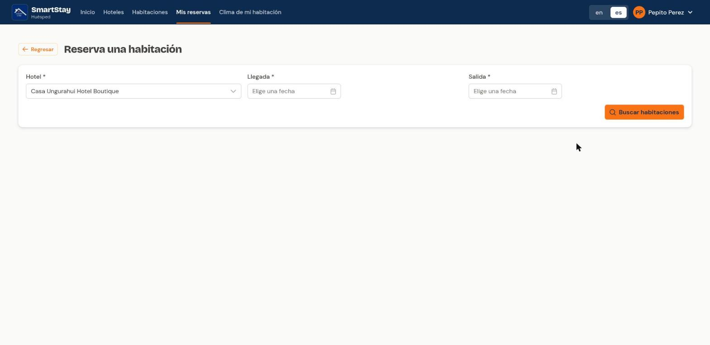

**Problema 4 (severidad 3).** *Acceso a la aplicación.* La medición con Lighthouse del 09/11/2026 (apartado 7.4.2) dio 88 en accesibilidad para el login: contraste insuficiente entre texto y fondo, atributos `aria-*` que no coinciden con sus roles y ausencia de un elemento de referencia `main`. *Recomendación:* ajustar los colores para alcanzar la relación de contraste 4.5:1, corregir los roles y envolver el contenido en `main`.

**Problemas 5 y 6 (severidad 2).** *Tareas 2 y 3.* El filtro por tipo muestra un campo vacío y su etiqueta aparece debajo; el buscador de hoteles no tiene etiqueta visible. *Recomendación:* etiquetas sobre los controles, valor inicial «Todos los tipos» y el icono de búsqueda dentro del campo.

**Problema 7 (severidad 2).** *Tareas 2 y 3.* Las habitaciones visibles no tienen foto y una de las tarjetas de hotel muestra una imagen que parece una captura de un documento. *Recomendación:* cargar fotos reales de hoteles y habitaciones y definir un formato mínimo de imagen en el alta.

**Problema 8 (severidad 1).** *Tarea 2, en móvil.* El título de la lista de hoteles queda con un margen izquierdo mayor que el resto del contenido.

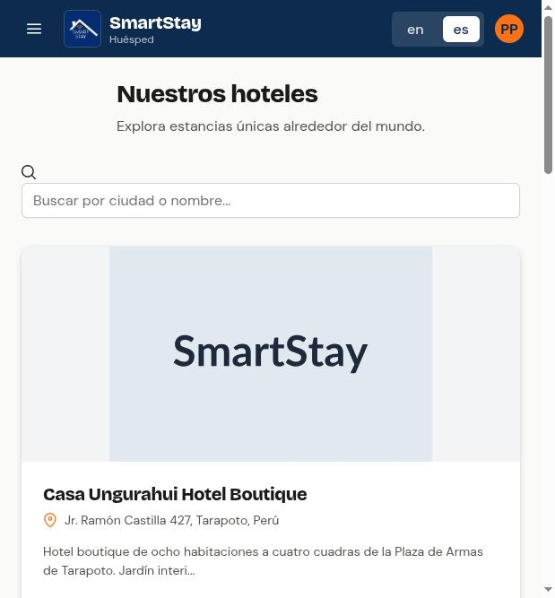

**Problema 9 (severidad 2).** *Acceso a la aplicación.* Lighthouse reportó 83 en SEO para el login por falta de `meta description` y porque `/robots.txt` devuelve `index.html`, debido a la regla de reescritura de `vercel.json`. *Recomendación:* añadir la `meta description` y servir un `robots.txt` válido como archivo estático.

**Pantallas evaluadas**

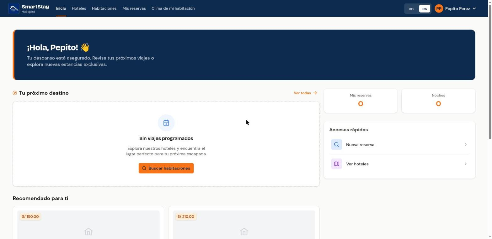

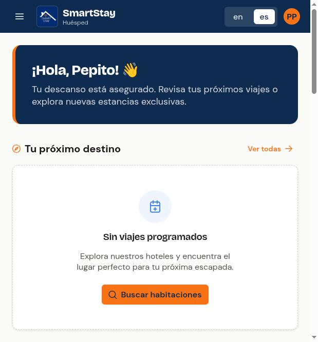

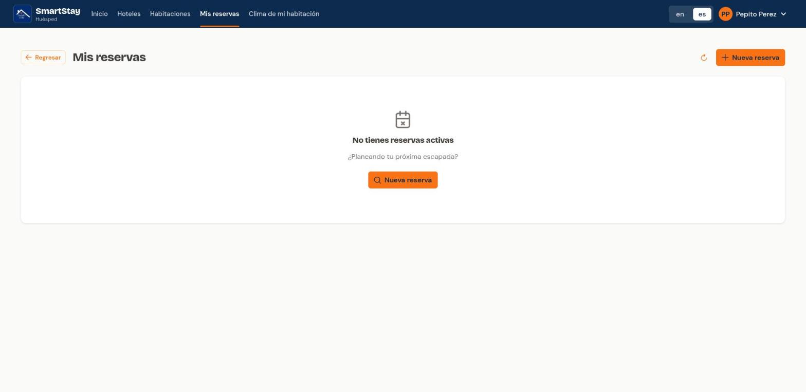

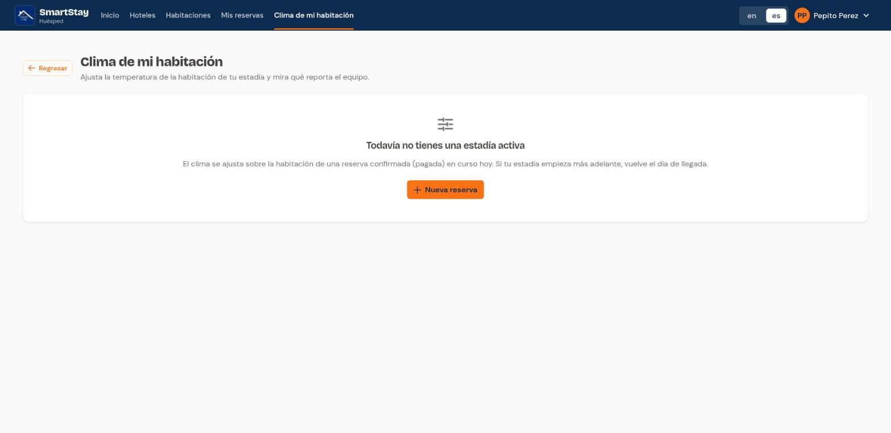

> **Pendiente:** la misma evaluación con el panel de administrador y personal, la aplicación móvil y las sesiones con usuarios de 6.3.2.

--- | :--- |
| Encabezado | Carrera, curso, NRC, profesores, auditor (SmartStay Team) y clientes que participan en la sesión |
| Site o app a evaluar | Landing Page, aplicación web y aplicación móvil de SmartStay |
| Tareas a evaluar | Las tareas de 6.3.1; quedan fuera del alcance los flujos del Sprint 3 aún no desplegados |
| Escala de severidad | 1 = problema superficial, 2 = problema menor, 3 = problema mayor, 4 = problema muy grave |
| Tabla resumen | Problema encontrado, severidad y heurística o principio violado (usabilidad, diseño inclusivo o arquitectura de información) |
| Detalle por problema | Tarea, descripción, evidencia en captura y recomendación |

---

<div style="page-break-after: always;"></div>

## 6.4. Auditoría de Experiencias de Usuario

La auditoría de experiencias de usuario es una evaluación cruzada entre grupos: SmartStay audita el producto de otro grupo y recibe la auditoría de un tercero sobre el suyo. Cada auditoría evalúa los productos desplegados con el formato de evaluación heurística del Anexo D del enunciado.

> **Pendiente:** al momento de este avance el grupo no tiene asignado un grupo auditado ni ha recibido una auditoría. Las secciones siguientes se completan cuando se coordine el intercambio, y no se presentan datos de auditoría hasta contar con ellos.

### 6.4.1. Auditoría realizada

#### 6.4.1.1. Información del grupo auditado

Se registrará el nombre de la startup auditada, el nombre de su producto, sus integrantes y las URL de los productos evaluados.

#### 6.4.1.2. Cronograma de auditoría realizada

Se registrará la fecha, la hora, la modalidad y los participantes de cada sesión de auditoría.

#### 6.4.1.3. Contenido de auditoría realizada

Se incluirá el formato de evaluación heurística completo con las tareas evaluadas, los problemas encontrados, su severidad y la heurística o principio violado.

### 6.4.2. Auditoría recibida

#### 6.4.2.1. Información del grupo auditor

Se registrará el nombre del grupo que audita a SmartStay, sus integrantes y el contacto de coordinación.

#### 6.4.2.2. Cronograma de auditoría recibida

Se registrará la fecha, la hora, la modalidad y los participantes de cada sesión.

#### 6.4.2.3. Contenido de auditoría recibida

Se incluirá el formato de evaluación heurística recibido, con los problemas reportados sobre el Landing Page y las aplicaciones de SmartStay.

#### 6.4.2.4. Resumen de modificaciones para subsanar hallazgos

Se presentará una tabla que relacione cada hallazgo recibido con el cambio realizado en el producto, el commit que lo implementó y el estado de la corrección.
