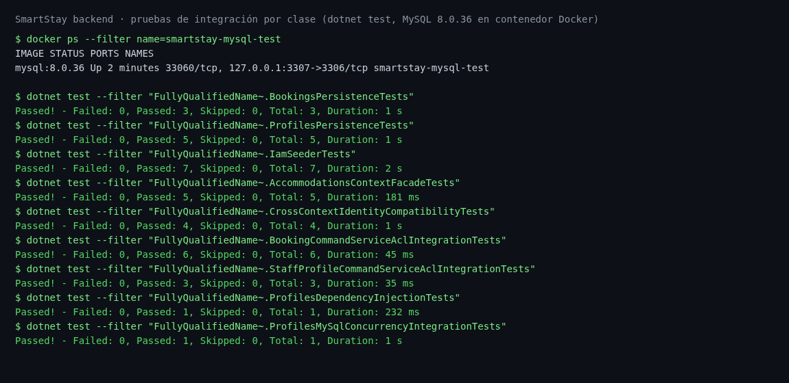
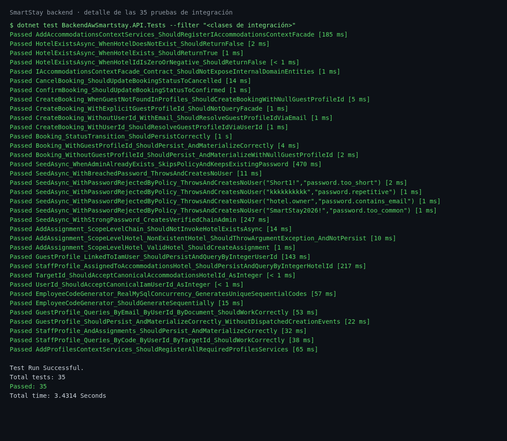
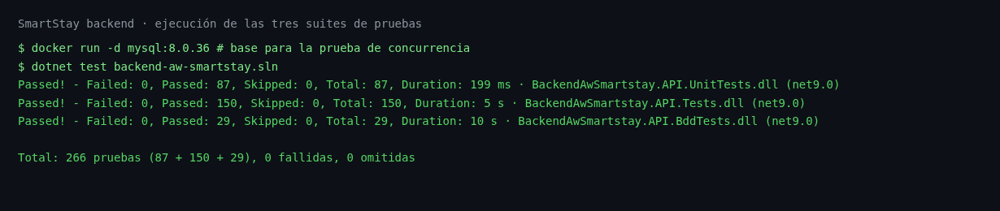

# Capítulo VI: Product Verification & Validation

## 6.1. Testing Suites & Validation

La estrategia de validación de SmartStay cubre los tres servicios principales: **el backend, la aplicación web y la aplicación móvil.** 

Los tres repositorios fueron sujetos a pruebas unitarias, pruebas de integración, entre otras.

### 6.1.1. Core Entities Unit Tests.

Las pruebas unitarias verifican las entidades, agregados, objetos de valor y servicios de aplicación de cada contexto delimitado de forma aislada, sin base de datos real. En el backend se organizan en dos proyectos NUnit, y en la aplicación móvil se escriben con `flutter_test`.

#### Backend (ASP.NET Core 9, NUnit)

| Proyecto | Contextos y áreas cubiertas | Pruebas |
|---|---|---:|
| `BackendAwSmartstay.API.UnitTests` | **Bookings:** Domain (`BookingTests`). **Payments:** Application, Domain e Infrastructure (pasarelas manual y simulada de tarjeta, `CardDetails`, `Payment`). | 87 |
| `BackendAwSmartstay.API.Tests` | **Accommodations:** Application (fachadas ACL). **Bookings:** Application, Domain e Infrastructure. **IAM:** Infrastructure. **Profiles:** Application, Compatibility, Domain (Aggregates, Entities, ValueObjects), Infrastructure/Persistence e Interfaces/REST. | 150 |

Ambos proyectos se ejecutaron con `dotnet test` el 9 de noviembre de 2026 y todas las pruebas pasaron (0 fallidas, 0 omitidas). Esta organización permite ubicar cada prueba según el contexto y la responsabilidad del componente: las áreas de dominio corresponden a entidades y reglas de negocio; las de aplicación, a la coordinación de operaciones; y las de infraestructura, a mecanismos como la persistencia. Las secciones de compatibilidad e interfaces del contexto Profiles cubren la lectura de datos previos y los controladores REST.

*Estructura del proyecto de pruebas del backend y ejecución exitosa*


*Prueba de persistencia de Payments*


#### Aplicación móvil (Flutter, `flutter_test`)

La aplicación móvil cuenta con 16 pruebas en tres archivos, ejecutadas con `flutter test` el 9 de noviembre de 2026 (16 aprobadas):

| Archivo | Qué verifica | Pruebas |
|---|---|---:|
| `test/staff_models_test.dart` | Matriz de permisos por rol (recepción, housekeeping, huésped y roles desconocidos), lectura de `BookingResource`, expiración y cancelación de reservas, resolución de reservas por día del calendario, mapa de habitaciones por estado, pagos en efectivo sin número de operación y cálculo de fechas | 9 |
| `test/guest_booking_api_test.dart` | Validación de tarjeta (`CardDetails.parse`), creación de reserva, error del backend al reservar, pago con tarjeta y cancelación rechazada | 6 |
| `test/widget_test.dart` | La aplicación del huésped carga correctamente | 1 |

#### Aplicación web

El frontend web (Vue 3 + Vite) no cuenta aún con una suite de pruebas unitarias automatizadas. Su verificación funcional se documenta en la sección 6.1.4.

### 6.1.2. Core Integration Tests.

Las pruebas de integración verifican que varios componentes funcionan correctamente **juntos**: servicios de aplicación con repositorios, repositorios con Entity Framework, y contextos delimitados que se comunican por sus fachadas ACL. En el backend son 35 pruebas del proyecto `BackendAwSmartstay.API.Tests`, ejecutadas con `dotnet test` el 9 de noviembre de 2026 (35 aprobadas, 0 fallidas).

| Clase de pruebas | Contexto | Qué integra | Pruebas |
|---|---|---|---:|
| `BookingsPersistenceTests` | Bookings | Agregado `Booking` con EF Core: persistencia, estados y reserva con y sin perfil de huésped | 3 |
| `BookingCommandServiceAclIntegrationTests` | Bookings ↔ Profiles | Servicio de comandos con la fachada de perfiles: resuelve el huésped por usuario o correo, o crea la reserva sin perfil si no existe | 6 |
| `ProfilesPersistenceTests` | Profiles | Perfiles de huésped y de staff con EF Core: persistencia, consultas y generador de códigos de empleado | 5 |
| `StaffProfileCommandServiceAclIntegrationTests` | Profiles ↔ Accommodations | Asignación de staff a hoteles validando el hotel por la fachada de alojamiento; rechaza hoteles inexistentes sin persistir | 3 |
| `AccommodationsContextFacadeTests` | Accommodations | Fachada ACL: existencia de hotel, ids inválidos y contrato sin exponer entidades internas | 5 |
| `CrossContextIdentityCompatibilityTests` | IAM ↔ Profiles ↔ Accommodations | Los ids enteros de usuario y de hotel son aceptados entre contextos | 4 |
| `IamSeederTests` | IAM | Alta del administrador de cadena con política de contraseñas; rechaza contraseñas filtradas, cortas, repetitivas, con el correo o comunes | 7 |
| `ProfilesDependencyInjectionTests` | Profiles | Registro de servicios del contexto en el contenedor de dependencias | 1 |
| `ProfilesMySqlConcurrencyIntegrationTests` | Profiles | Generación concurrente de códigos de empleado sobre MySQL 8.0.36 real (contenedor Docker) | 1 |
| **Total** | | | **35** |

Las pruebas cubren tanto caminos felices como caminos de fallo: hotel inexistente, huésped sin perfil, contraseñas rechazadas por política o filtradas, e identificadores no válidos.

*Código de una de las pruebas de integración (`BookingCommandServiceAclIntegrationTests`)*


*Ejecución de las pruebas de integración, resumen por clase*



*Ejecución de las pruebas de integración, detalle de las 35 pruebas*



**Base de datos de las pruebas.** La mayoría de estas pruebas usan Entity Framework en memoria y fachadas o repositorios de prueba para aislar la lógica. La prueba de concurrencia (`ProfilesMySqlConcurrencyIntegrationTests`) se ejecuta contra un **MySQL 8.0.36 real**: diez contextos de EF generan códigos de empleado en paralelo y se verifica que los diez códigos son únicos y siguen el formato `EMP-00000`. En desarrollo local se usa un contenedor Docker de MySQL (`docker-compose.yml`) indicado con la variable `TEST_MYSQL_CONNECTION`; en el CI de GitHub Actions el job `build-and-test` levanta un contenedor de servicio `mysql:8.0.36` y define `REQUIRE_MYSQL_TESTS=true`, de modo que si la base no está disponible la prueba falla en lugar de omitirse.

#### Aplicación móvil

`test/guest_booking_api_test.dart` prueba el cliente HTTP de reservas contra respuestas simuladas del backend: creación de reserva, error devuelto por el backend, pago con tarjeta rechazado y cancelación no aceptada. Verifica el contrato entre la aplicación móvil y la API, sin levantar el backend real.

#### Aplicación web

El frontend web no cuenta con pruebas de integración automatizadas.

### 6.1.3. Core Behavior-Driven Development

Para verificar el comportamiento del software desde la perspectiva del negocio y del usuario final, se implementó una suite de pruebas automatizadas bajo el enfoque **Behavior-Driven Development (BDD)**. Se creó el proyecto dedicado `BackendAwSmartstay.API.BddTests` integrado a la solución backend sobre **.NET 9**, utilizando **Reqnroll (v2.3.0)** sobre **NUnit (v4.2.2)**, **FluentAssertions (v7.2.0)** y aislamiento de persistencia en memoria mediante `Microsoft.EntityFrameworkCore.InMemory`.

#### 1. Cobertura de User Stories y Escenarios BDD

Se implementaron **29 escenarios** en sintaxis Gherkin, distribuidos en **9 User Stories** del Product Backlog. Cada escenario está etiquetado según el tipo de camino que verifica: `@happy-path` para el flujo esperado, y `@negative`, `@validation`, `@boundary` o `@security` para los caminos alternos (rechazos, validaciones, casos límite y seguridad).

| User Story | Título | Contexto | Escenarios | Camino feliz | Caminos alternos |
| --- | --- | --- | ---: | ---: | ---: |
| **US-01** | Registro de usuario | IAM | 3 | 1 | 2 |
| **US-02** | Inicio de sesión seguro | IAM | 3 | 1 | 2 |
| **US-03** | Gestión de perfiles y roles | IAM / Profiles | 3 | 2 | 1 |
| **US-04** | Recuperación de contraseña | IAM | 3 | 2 | 1 |
| **US-52** | Autenticación de dos factores para staff | IAM | 3 | 2 | 1 |
| **US-06** | Gestión de habitaciones y estados | Accommodations | 3 | 2 | 1 |
| **US-53** | Configuración de hotel y habitaciones | Accommodations | 3 | 1 | 2 |
| **US-07** | Gestión centralizada de reservas | Bookings | 3 | 3 | 0 |
| **US-51** | Reserva de habitación por huésped | Bookings | 5 | 1 | 4 |
| **Total** | **9 historias** | **3 contextos** | **29** | **15** | **14** |

#### 2. Especificación de Escenarios Gherkin (`.feature`)

Los archivos `.feature` capturan los criterios de aceptación en lenguaje de negocio mediante la estructura `Given-When-Then`, con el texto de los pasos en español. A continuación se muestran dos de los nueve archivos, tal como están en el repositorio.

Las fechas de los escenarios de reservas se escriben de forma relativa a la fecha de ejecución (`hoy+30` equivale a treinta días después de hoy, y `hoy-3` a tres días antes), para que las pruebas no dejen de pasar cuando el calendario avanza.

##### Archivo: `US51_ReservaHabitacionPorHuesped.feature` (Contexto Bookings)

```gherkin
@US-51
@Bookings
Feature: Reserva de habitación por huésped

  Como huésped del hotel SmartStay
  Quiero reservar una habitación disponible para mis fechas de estadía
  Para asegurar mi alojamiento de forma confiable

  @US-51
  @happy-path
  Scenario: Registrar una reserva para una habitación disponible
    Given que existe un hotel registrado y operativo
    And existe una habitación "101" de tipo "Double" disponible con precio por noche de 150.00 soles
    And existe un huésped registrado con correo "juan.perez@smartstay.pe" y nombre "Juan Perez"
    When el huésped solicita registrar una reserva desde "hoy+30" hasta "hoy+34"
    Then la reserva debe crearse exitosamente
    And el estado inicial de la reserva debe ser "Pending"
    And la reserva debe contener un código de reserva generado
    And la reserva debe estar asociada a la habitación "101"

  @US-51
  @negative
  Scenario: Rechazar una reserva que se superpone con otra reserva existente
    Given que existe un hotel registrado y operativo
    And existe una habitación "102" de tipo "Single" disponible con precio por noche de 100.00 soles
    And existe una reserva activa para la habitación "102" del "hoy+39" al "hoy+44"
    When otro huésped intenta registrar una reserva para la habitación "102" del "hoy+41" al "hoy+43"
    Then la solicitud de reserva debe ser rechazada indicando que la habitación no está disponible

  @US-51
  @validation
  Scenario: Rechazar una reserva cuya fecha de salida no sea posterior a la fecha de entrada
    Given que existe un hotel registrado y operativo
    And existe una habitación "103" de tipo "Suite" disponible con precio por noche de 250.00 soles
    And existe un huésped registrado con correo "maria.lopez@smartstay.pe" y nombre "Maria Lopez"
    When el huésped solicita registrar una reserva desde "hoy+39" hasta "hoy+37"
    Then la solicitud de reserva debe ser rechazada por rango de fechas inválido

  @US-51
  @boundary
  Scenario: Permitir una reserva que comienza el mismo día en que termina la reserva anterior
    Given que existe un hotel registrado y operativo
    And existe una habitación "104" de tipo "Double" disponible con precio por noche de 180.00 soles
    And existe una reserva activa para la habitación "104" del "hoy+30" al "hoy+34"
    When un nuevo huésped solicita registrar una reserva para la habitación "104" del "hoy+34" al "hoy+39"
    Then la reserva debe crearse exitosamente
    And el estado inicial de la reserva debe ser "Pending"

  @US-51
  @validation
  @negative
  Scenario: Rechazar una reserva cuya fecha de entrada ya pasó
    Given que existe un hotel registrado y operativo
    And existe una habitación "105" de tipo "Single" disponible con precio por noche de 100.00 soles
    And existe un huésped registrado con correo "carlos.ruiz@smartstay.pe" y nombre "Carlos Ruiz"
    When el huésped solicita registrar una reserva desde "hoy-3" hasta "hoy-1"
    Then la solicitud de reserva debe ser rechazada porque la fecha de entrada ya pasó
```

##### Archivo: `US06_GestionHabitacionesYEstados.feature` (Contexto Accommodations)

```gherkin
@US-06
@Accommodations
Feature: Gestión de habitaciones y estados

  Como personal del hotel (Staff / Housekeeping / Maintenance)
  Quiero actualizar el estado operativo de una habitación
  Para reflejar con precisión su disponibilidad y control en el sistema

  @US-06
  @happy-path
  Scenario: Cambiar el estado de una habitación de Disponible a Mantenimiento
    Given que existe una habitación "301" en estado "Available"
    When el personal solicita cambiar el estado de la habitación "301" a "Maintenance"
    Then el estado de la habitación "301" debe actualizarse a "Maintenance"

  @US-06
  @happy-path
  Scenario: Cambiar el estado de una habitación de Limpieza a Disponible
    Given que existe una habitación "302" en estado "Cleaning"
    When el personal solicita cambiar el estado de la habitación "302" a "Available"
    Then el estado de la habitación "302" debe actualizarse a "Available"

  @US-06
  @negative
  Scenario: Rechazar una transición de estado no permitida para la habitación
    Given que existe una habitación "303" en estado "Occupied"
    When el personal solicita cambiar el estado de la habitación "303" a "Available"
    Then la solicitud de cambio de estado debe ser rechazada por transición no permitida
```

#### 3. Implementación de Step Definitions en C# (.NET 9)

La vinculación entre los pasos Gherkin y los servicios del backend se implementa con clases decoradas con el atributo `[Binding]` de Reqnroll. Cada clase usa los servicios de aplicación reales del contexto, con repositorios y fachadas de prueba. A continuación se muestran fragmentos de `US51_ReservaHabitacionStepDefinitions.cs`.

```csharp
[Given(@"existe una habitación ""(.*)"" de tipo ""(.*)"" disponible con precio por noche de (.*) soles")]
public void GivenExisteUnaHabitacionDeTipoDisponibleConPrecioPorNocheDeSoles(string number, string type, decimal price)
{
    _roomNumber = number;
    _roomId = int.Parse(number);
    _roomType = type;
    _roomPrice = price;
}

[When(@"el huésped solicita registrar una reserva desde ""(.*)"" hasta ""(.*)""")]
public async Task WhenElHuespedSolicitaRegistrarUnaReservaDesdeHasta(string checkIn, string checkOut)
{
    try
    {
        var service = CreateService();
        var command = new CreateBookingCommand(
            Requester: BookingRequester.Guest(_guestUserId, _guestEmail),
            RoomId: _roomId,
            GuestName: _guestName,
            GuestEmail: _guestEmail,
            CheckInDate: RelativeDates.Parse(checkIn),
            CheckOutDate: RelativeDates.Parse(checkOut),
            UserId: _guestUserId);

        _createdBooking = await service.Handle(command);
    }
    catch (Exception ex)
    {
        _caughtException = ex;
    }
}

[Then(@"la solicitud de reserva debe ser rechazada porque la fecha de entrada ya pasó")]
public void ThenLaSolicitudDeReservaDebeSerRechazadaPorqueLaFechaDeEntradaYaPaso()
{
    _caughtException.Should().BeOfType<DomainValidationException>()
        .Which.Code.Should().Be(BookingErrorCodes.CheckInInPast);
    _createdBooking.Should().BeNull();
}
```

El helper `RelativeDates` interpreta las fechas relativas de los escenarios:

```csharp
/// <summary>
/// Resolves the dates written in Gherkin scenarios. Besides ISO dates it understands
/// <c>hoy+N</c> (N days after today) or <c>hoy-N</c> (N days before), so scenarios never go stale as the calendar moves.
/// </summary>
public static class RelativeDates
{
    private const string Today = "hoy";

    public static DateTime Parse(string text)
    {
        var value = text.Trim();
        if (value.StartsWith(Today, StringComparison.OrdinalIgnoreCase) && value.Length > Today.Length
            && value[Today.Length] is '+' or '-')
        {
            var days = int.Parse(value[Today.Length..], System.Globalization.CultureInfo.InvariantCulture);
            return DateTime.UtcNow.Date.AddDays(days);
        }

        return DateTime.Parse(value, System.Globalization.CultureInfo.InvariantCulture);
    }
}
```

#### 4. Resultados de Ejecución

El 9 de noviembre de 2026 se ejecutó `dotnet test` sobre la solución completa, con un contenedor de MySQL 8.0.36 para la prueba de concurrencia. Pasaron las 266 pruebas de las tres suites, sin fallos ni omisiones:

| Suite de pruebas | Framework | Tipo de prueba | Total | Aprobadas | Fallidas |
| --- | --- | --- | ---: | ---: | ---: |
| `BackendAwSmartstay.API.UnitTests` | NUnit | Unitarias de dominio y aplicación (Bookings y Payments) | 87 | 87 | 0 |
| `BackendAwSmartstay.API.Tests` | NUnit | Unitarias e integración (Accommodations, Bookings, IAM y Profiles) | 150 | 150 | 0 |
| `BackendAwSmartstay.API.BddTests` | Reqnroll + NUnit | Comportamiento (BDD / Gherkin) | 29 | 29 | 0 |
| **Total** | | | **266** | **266** | **0** |



### 6.1.4. Core System Tests

Se ejecutó una prueba funcional automatizada con Selenium sobre el formulario de inicio de sesión del frontend. Se utilizó Chrome visible y la instancia local del frontend en `http://localhost:5173/login`. El caso dejó vacíos el correo electrónico y la contraseña y trató de enviar el formulario.

| Aplicación | Caso | Resultado esperado | Resultado observado | Estado |
|---|---|---|---|---|
| Frontend web | Enviar el inicio de sesión con ambos campos vacíos | Impedir el envío y mostrar una validación en cada campo obligatorio | La ruta se mantuvo en `/login` y aparecieron dos mensajes «Este campo es obligatorio.» | Aprobado |
| Backend | Validar el comportamiento del controlador de staff con datos de prueba | Verificar que el controlador de staff maneja correctamente los datos de prueba | El controlador de staff maneja correctamente los datos de prueba | Aprobado |
| Mobile | Validar el comportamiento del widget de staff con datos de prueba | Verificar que el widget de staff maneja correctamente los datos de prueba | El widget de staff maneja correctamente los datos de prueba | Aprobado |

Esta ejecución solo confirma la validación de campos vacíos en ese formulario. No verifica autenticación con credenciales, permisos por rol, conexión con el backend, ni otros flujos de la aplicación web. No se guardó una captura ni un reporte de Selenium.

Para el backend, se validó el comportamiento del controlador de staff con datos de prueba.

Por ejemplo, la prueba `StaffControllerTest` verifica el comportamiento del controlador de staff con datos de prueba.


En el frontend, se validó el login/registro con campos de prueba y los resultados fueron los esperados.

