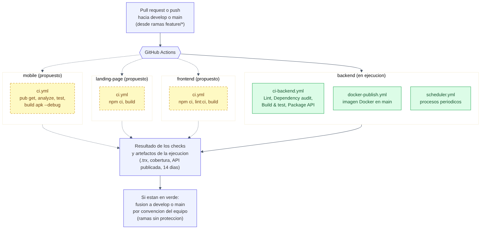
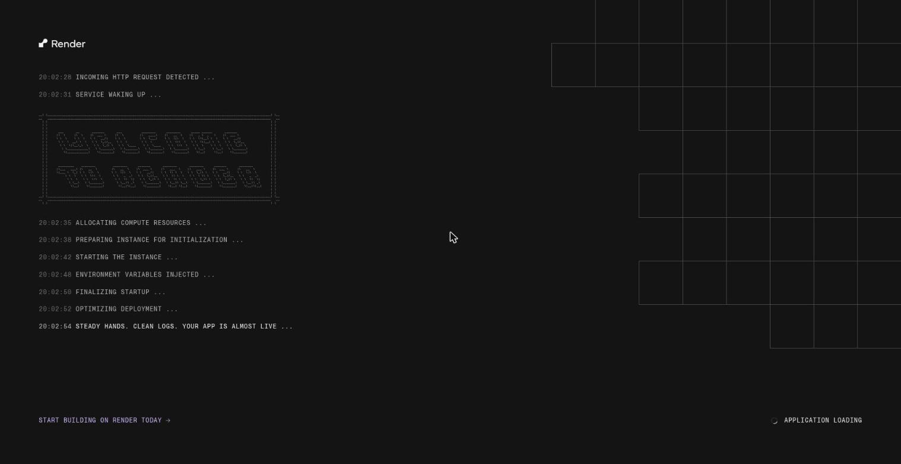
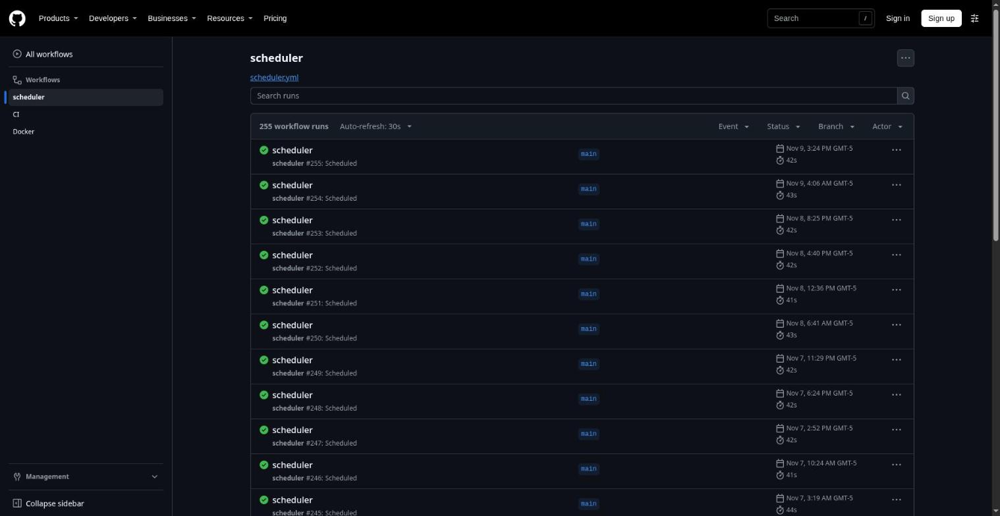
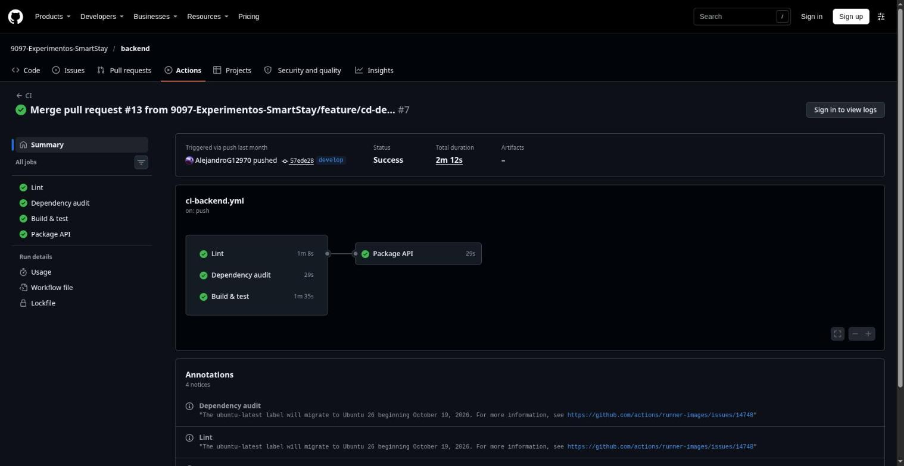
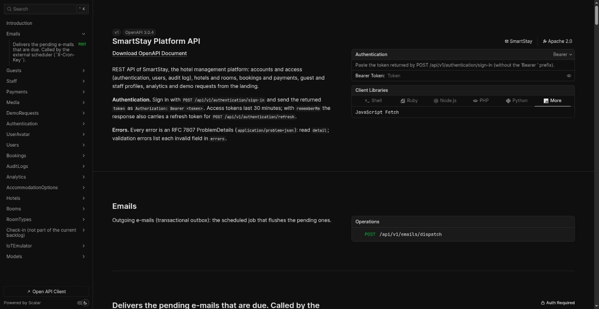
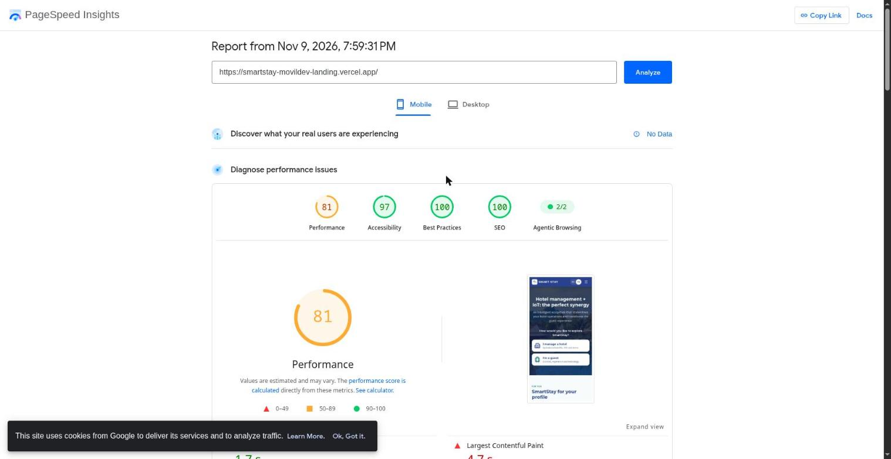
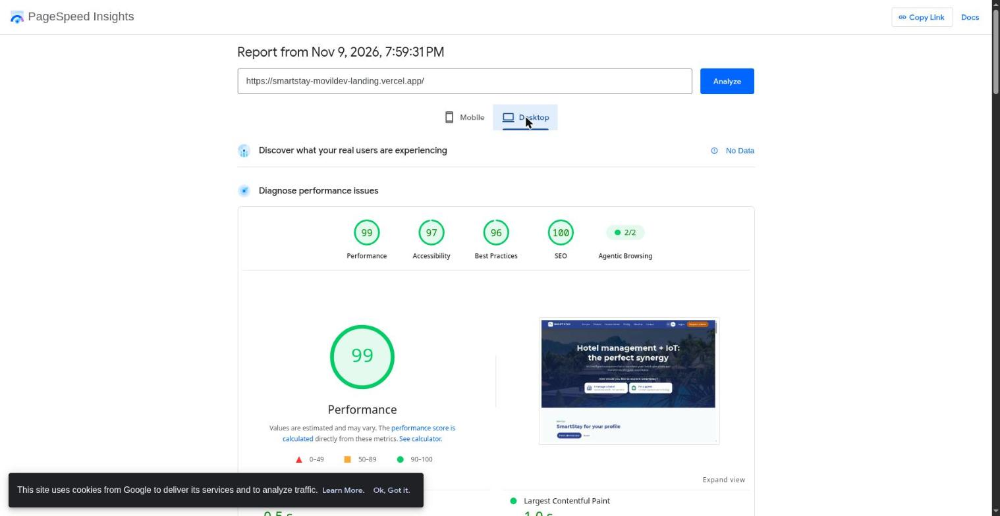
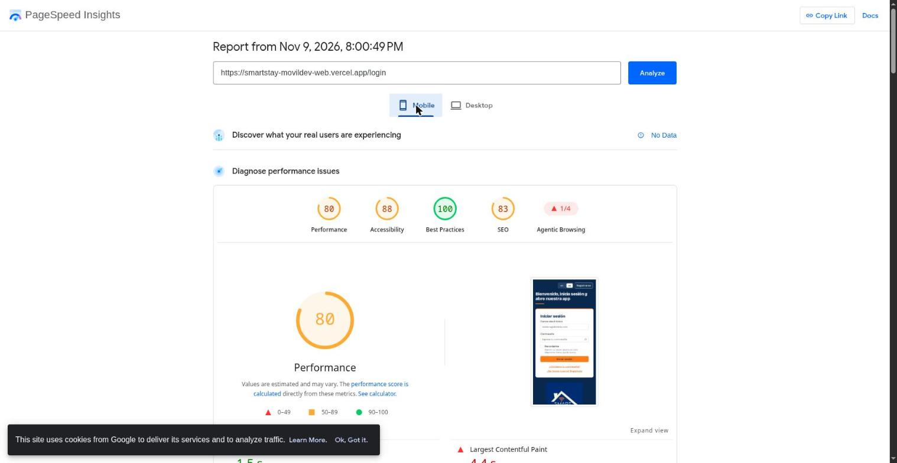
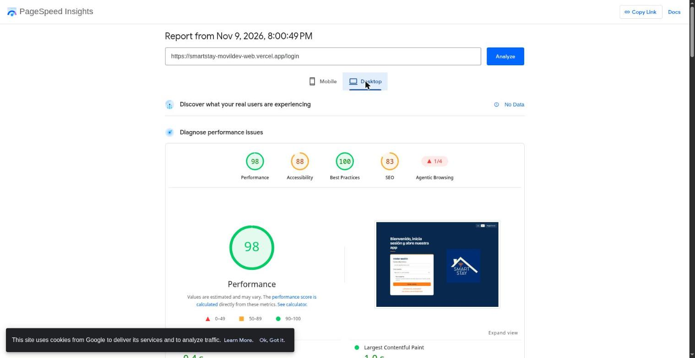

# Capítulo VII: DevOps Practices

## 7.1. Continuous Integration

La Integración Continua (CI) en la plataforma SmartStay reúne las prácticas y la automatización que validan, compilan y verifican cada incremento de código del equipo. La solución tiene cuatro componentes con tecnologías distintas: un backend RESTful en ASP.NET Core (.NET 9), una aplicación web en Vue 3 con Vite y PrimeVue, una landing page en JavaScript con Vite y Tailwind CSS, y una aplicación móvil en Flutter (Dart). Cada componente vive en su propio repositorio de GitHub y se integra bajo el flujo de trabajo GitFlow.

**Estado actual.** El backend es el único repositorio con un pipeline de CI en `develop` y `main` (`ci-backend.yml`). Para el frontend web, la landing page y la aplicación móvil se definieron workflows equivalentes (`ci.yml`) en la rama `feature/av2-ci` de cada repositorio, pendientes de fusión. En este capítulo se distingue siempre entre lo que ya está en ejecución y lo que está propuesto.

<!-- Diagrama del equipo (assets/chapter-7/ContinuousIntegration/ContinuousIntegration1.jpeg) retirado: muestra una app móvil Android/Kotlin y un paso de CodeReview automático que no existen. Reemplazar por un diagrama actualizado. -->



---

### 7.1.1. Tools and Practices

Para garantizar que el código integrado sea funcional, seguro y conforme a los lineamientos arquitectónicos, se establecieron las siguientes herramientas y prácticas operativas:

#### 1. Herramientas de Integración Continua

* **GitHub Actions:** orquestador de la automatización. Los flujos se declaran en archivos YAML dentro de `.github/workflows/`. En el backend existen `ci-backend.yml` (integración), `docker-publish.yml` (imagen Docker) y `scheduler.yml` (procesos periódicos).

* **Entornos de ejecución:**
  * Backend: **.NET SDK 9** (`actions/setup-dotnet`), con caché de paquetes NuGet entre ejecuciones.
  * Frontend web y landing page: **Node.js 22** con `npm ci` (workflows propuestos).
  * Aplicación móvil: **Flutter** en el canal estable, mediante `subosito/flutter-action` (workflow propuesto).

* **Herramientas de análisis estático:**
  * Backend: `dotnet format --verify-no-changes` para el formato del código y compilación con `--warnaserror` para tratar las advertencias como errores.
  * Frontend web: **ESLint 8** con `plugin:vue/vue3-essential` (configuración y workflow propuestos).
  * Aplicación móvil: `flutter analyze` con el conjunto `flutter_lints` (workflow propuesto).

* **Auditoría de dependencias:** `dotnet list package --vulnerable --include-transitive` en el job *Dependency audit* del backend. En el frontend y la landing page, `npm audit` se ejecutó de forma manual (apartado 6.2.1.2).

#### 2. Prácticas de Ingeniería Aplicadas

* **Integración mediante *pull requests* y commits convencionales:** el trabajo se desarrolla en ramas `feature/*`, se integra en `develop` y se libera en `main`. Los mensajes de commit siguen Conventional Commits (`feat:`, `fix:`, `docs:`, `ci:`, `style:`).

* **Compilación sin advertencias:** el job de compilación del backend usa `--warnaserror`, de modo que cualquier advertencia del compilador detiene el pipeline.

* **Verificación de formato y de dependencias vulnerables como trabajos independientes:** *Lint* y *Dependency audit* corren en paralelo con *Build & test*, y el empaquetado (*Package API*) solo se ejecuta en un *push* y únicamente si los tres anteriores pasan.

* **Cancelación de ejecuciones obsoletas:** cada workflow usa `concurrency` con `cancel-in-progress`, de modo que una ejecución nueva sobre la misma rama cancela la anterior.

* **Resultados como artefactos:** los reportes de pruebas (`.trx`) y de cobertura se publican como artefactos de la ejecución, con una retención de 14 días.

* **Protección de ramas:** a la fecha **no está habilitada** en ninguno de los cuatro repositorios (GitHub responde «Branch not protected» para `main` y `develop`), por lo que la revisión entre pares y los *checks* obligatorios no los exige la plataforma. Se recomienda activarla (apartado 6.2.2).

---

### 7.1.2. Build & Test Suite Pipeline Components

El pipeline de construcción y pruebas se estructura en trabajos independientes. En el backend se ejecuta en cada *push* y *pull request* hacia `develop` y `main`.

<!-- Diagrama del equipo (assets/chapter-7/BuildTest/PipelineComponents.jpeg) retirado: debe actualizarse para reflejar los trabajos reales de cada repositorio. -->

#### 1. Componentes del Pipeline por Plataforma

* **Backend (`backend`), en ejecución:**
  * *Lint:* `dotnet restore` y `dotnet format --verify-no-changes`.
  * *Dependency audit:* falla si `dotnet list package --vulnerable --include-transitive` encuentra paquetes vulnerables.
  * *Build & test:* `dotnet build --configuration Release --warnaserror` y `dotnet test` sobre la solución completa, que ejecuta las tres suites: `BackendAwSmartstay.API.UnitTests` (pruebas unitarias de Bookings y Payments), `BackendAwSmartstay.API.Tests` (pruebas de dominio, aplicación, infraestructura e interfaces de Accommodations, Bookings y Profiles) y `BackendAwSmartstay.API.BddTests` (28 escenarios Gherkin con Reqnroll). Publica los resultados y la cobertura como artefactos.
  * *Package API:* `dotnet publish` del proyecto de la API, solo en un *push* y tras los tres trabajos anteriores.

* **Frontend web (`frontend`), propuesto:** `npm ci`, `npm run lint:ci` (ESLint, que hoy reporta 25 errores y por eso se configuró con `continue-on-error`) y `npm run build`. El repositorio no tiene pruebas automatizadas.

* **Landing page (`landing-page`), propuesto:** `npm ci` y `npm run build`. El repositorio no tiene linter ni pruebas automatizadas.

* **Aplicación móvil (`mobile`), propuesto:** `flutter pub get`, `flutter analyze`, `flutter test --coverage` (16 casos en tres archivos) y `flutter build apk --debug` para comprobar que la aplicación compila.

#### 2. Declaración del Workflow de Integración

A continuación, se documenta el workflow de CI del backend (`.github/workflows/ci-backend.yml`), tal como está en la rama `develop`:

```yaml
name: CI

on:
  pull_request:
    branches: [develop, main]
  push:
    branches: [develop, main]
  workflow_dispatch:

permissions:
  contents: read

concurrency:
  group: ci-${{ github.ref }}
  cancel-in-progress: true

env:
  SOLUTION: backend-aw-smartstay.sln
  API_PROJECT: BackendAwSmartstay.API/BackendAwSmartstay.API.csproj
  DOTNET_VERSION: 9.0.x
  DOTNET_NOLOGO: true
  DOTNET_CLI_TELEMETRY_OPTOUT: true

jobs:
  lint:
    name: Lint
    runs-on: ubuntu-latest
    timeout-minutes: 10
    steps:
      - uses: actions/checkout@v7

      - uses: actions/setup-dotnet@v6
        with:
          dotnet-version: ${{ env.DOTNET_VERSION }}

      - uses: actions/cache@v6
        with:
          path: ~/.nuget/packages
          key: nuget-${{ runner.os }}-${{ hashFiles('**/*.csproj') }}
          restore-keys: nuget-${{ runner.os }}-

      - name: Restore
        run: dotnet restore "$SOLUTION"

      - name: Verify code formatting
        run: dotnet format "$SOLUTION" --verify-no-changes --no-restore

  dependency-audit:
    name: Dependency audit
    runs-on: ubuntu-latest
    timeout-minutes: 10
    steps:
      - uses: actions/checkout@v7

      - uses: actions/setup-dotnet@v6
        with:
          dotnet-version: ${{ env.DOTNET_VERSION }}

      - uses: actions/cache@v6
        with:
          path: ~/.nuget/packages
          key: nuget-${{ runner.os }}-${{ hashFiles('**/*.csproj') }}
          restore-keys: nuget-${{ runner.os }}-

      - name: Restore
        run: dotnet restore "$SOLUTION"

      - name: Fail on vulnerable packages
        run: |
          dotnet list "$SOLUTION" package --vulnerable --include-transitive | tee vulnerable-packages.txt
          ! grep -q "has the following vulnerable packages" vulnerable-packages.txt

  build-and-test:
    name: Build & test
    runs-on: ubuntu-latest
    timeout-minutes: 15
    steps:
      - uses: actions/checkout@v7

      - uses: actions/setup-dotnet@v6
        with:
          dotnet-version: ${{ env.DOTNET_VERSION }}

      - uses: actions/cache@v6
        with:
          path: ~/.nuget/packages
          key: nuget-${{ runner.os }}-${{ hashFiles('**/*.csproj') }}
          restore-keys: nuget-${{ runner.os }}-

      - name: Restore
        run: dotnet restore "$SOLUTION"

      - name: Build
        run: dotnet build "$SOLUTION" --configuration Release --no-restore --warnaserror

      - name: Test
        run: >
          dotnet test "$SOLUTION"
          --configuration Release
          --no-build
          --logger trx
          --results-directory TestResults
          --collect "XPlat Code Coverage"

      - name: Upload test results
        if: ${{ !cancelled() }}
        uses: actions/upload-artifact@v7
        with:
          name: test-results
          path: TestResults
          retention-days: 14

  package:
    name: Package API
    if: github.event_name == 'push'
    needs: [lint, dependency-audit, build-and-test]
    runs-on: ubuntu-latest
    timeout-minutes: 10
    steps:
      - uses: actions/checkout@v7

      - uses: actions/setup-dotnet@v6
        with:
          dotnet-version: ${{ env.DOTNET_VERSION }}

      - uses: actions/cache@v6
        with:
          path: ~/.nuget/packages
          key: nuget-${{ runner.os }}-${{ hashFiles('**/*.csproj') }}
          restore-keys: nuget-${{ runner.os }}-

      - name: Publish
        run: dotnet publish "$API_PROJECT" --configuration Release --output publish

      - uses: actions/upload-artifact@v7
        with:
          name: smartstay-api-${{ github.sha }}
          path: publish
          retention-days: 14
```

**Resultado observado.** La ejecución #7 de este workflow sobre `develop` (07/10/2026, tras fusionar el pull request #13) pasó sus cuatro trabajos en 2 min 12 s, con 265 pruebas superadas y ninguna fallida (apartado 7.4.2).

## 7.2. Continuous Delivery

La Entrega Continua (CD) en SmartStay busca que cada incremento validado quede empaquetado y listo para liberarse. Hoy esto se cumple para el backend, cuyo artefacto es una imagen Docker; el frontend web y la landing page se construyen y publican en Vercel, y la aplicación móvil no tiene un proceso de entrega automatizado. SmartStay **no cuenta con un entorno de *staging* separado**: los *pull requests* de los repositorios web generan despliegues de vista previa (*Preview*) en Vercel, y la validación de integración se hace en la rama `develop`.

### 7.2.1. Tools and Practices.

Para asegurar que cada versión generada sea reproducible y trazable, se emplean las siguientes herramientas y prácticas:

#### 1. Herramientas de Entrega Continua

* **GitHub Actions:** el workflow `docker-publish.yml` del backend se ejecuta en cada *push* a `main`, en cada *tag* `v*.*.*`, en cada *pull request* hacia `main` y diariamente a las 03:27 UTC. Construye la imagen Docker y solo la publica cuando el evento no es un *pull request*.

* **Docker y Docker Compose:**
  * El backend se empaqueta con un `Dockerfile` de varias etapas: compila con la imagen `mcr.microsoft.com/dotnet/sdk:9.0` y se ejecuta con `mcr.microsoft.com/dotnet/aspnet:9.0`.
  * `docker-compose.yml` levanta localmente el backend junto con una instancia de **MySQL 8.0**.

* **GitHub Container Registry (GHCR):** almacena las imágenes del backend en `ghcr.io/9097-experimentos-smartstay/backend`, etiquetadas por el *action* `docker/metadata-action`.

* **Cosign (Sigstore):** el workflow firma el *digest* de la imagen publicada, para verificar su integridad y procedencia.

* **GitHub Secrets y variables de entorno:** las credenciales (por ejemplo, `CRON_API_KEY` del scheduler) se guardan como secretos de GitHub. En Render, los secretos de la API se declaran con `sync: false` en `render.yaml` y no se versionan.

* **Entity Framework Core Migrations:** el backend aplica las migraciones pendientes y los datos semilla al arrancar (`MigrateAsync`, `SeedDatabaseAsync`).

* **Vercel (*Preview deployments*):** el frontend web y la landing page tienen entornos `Preview` y `Production`; cada *pull request* publica una vista previa para revisarla antes de integrar.

#### 2. Prácticas de Ingeniería Aplicadas

* **Build en CI:** la imagen y el paquete de la API se construyen en GitHub Actions; en un *pull request* la imagen se construye sin publicarse, para comprobar que es empaquetable.

* **Versionamiento semántico:** el workflow reconoce *tags* `v*.*.*` para etiquetar las imágenes, aunque a la fecha los repositorios aún no tienen ningún *tag* ni *release* publicado.

* **Configuración externalizada:** la configuración por entorno se separa del código mediante variables de entorno, archivos `.env.example` y `appsettings.{Environment}.json`.

* **Imagen firmada:** cada imagen publicada lleva una firma de Cosign, con registro en el log de transparencia de Sigstore.

* **Entrega móvil manual:** la aplicación móvil se compila con `flutter build apk`; el workflow propuesto solo comprueba que compila (`flutter build apk --debug`), y la distribución del APK sigue siendo manual.

### 7.2.2. Stages Deployment Pipeline Components.

El recorrido de un cambio sigue el flujo de ramas GitFlow: `feature/*` → *pull request* → `develop` → *pull request* → `main`. Cada etapa añade un nivel de verificación.

<!-- Diagrama del equipo (assets/chapter-7/ContinuousDelivery/StagesDeploymentPipeline.png) retirado: describía un entorno de staging, GitHub Releases para el APK y aprobaciones obligatorias que no existen. Reemplazar por un diagrama actualizado. -->

#### 1. Etapas del Pipeline

* **01 – Desarrollo local:** cada desarrollador trabaja en una rama `feature/*`.
  * El backend y MySQL se levantan con `docker compose up`.
  * El frontend web y la landing page se ejecutan con `npm run dev`.
  * La aplicación móvil se prueba con `flutter run`.

* **02 – Integración (`develop`):** al abrir un *pull request* hacia `develop`, o al fusionarse en ella, el backend ejecuta `ci-backend.yml` completo: formato, auditoría de dependencias, compilación sin advertencias y las 265 pruebas. Los resultados se publican como artefactos.

* **03 – Candidato a versión (*pull request* a `main`):** al abrir el *pull request* de `develop` hacia `main` se ejecutan de nuevo `ci-backend.yml` y la construcción de la imagen Docker sin publicarla. La aprobación de la fusión la decide el equipo por convención; GitHub no la exige, porque las ramas no están protegidas.

* **04 – Artefacto de versión (`main`):** al fusionarse en `main`, `docker-publish.yml` publica la imagen del backend en GHCR y la firma con Cosign. El *package* de la API de `ci-backend.yml` queda además como artefacto de la ejecución.

* **05 – Despliegue:** Render y Vercel despliegan desde `main`, como se describe en el apartado 7.3.

## 7.3. Continuous deployment

El Despliegue Continuo en SmartStay lleva a producción, sin intervención manual, los cambios integrados en `main`. Se aplica al backend (Render) y al frontend web y la landing page (Vercel). La aplicación móvil no se despliega de forma automática.

### 7.3.1. Tools and Practices.

Para desplegar en producción de forma segura y reversible, se emplean las siguientes herramientas y prácticas:

#### 1. Herramientas de Despliegue Continuo

* **Render (backend):** el archivo `render.yaml` define el servicio como un contenedor Docker en el plan gratuito, región Oregon, apuntando a la rama `main` del repositorio, con `healthCheckPath: /health` y `autoDeployTrigger: checksPass`, de modo que Render despliega solo cuando los *checks* de CI de GitHub pasan.

* **Vercel (frontend web y landing page):** `vercel.json` declara el *framework* Vite, el comando `npm run build` y el directorio de salida `dist`. En el frontend web añade una regla de reescritura que dirige todas las rutas a `index.html` para que funcione la navegación de la aplicación de una sola página. En la landing page añade caché inmutable para los recursos versionados y las cabeceras de seguridad `X-Content-Type-Options`, `Referrer-Policy`, `X-Frame-Options` y `Permissions-Policy`. Cada *push* a `main` publica una nueva versión de producción, y el historial de despliegues permite volver a una anterior.

* **Monitoreo del servicio desplegado:**
  * El *endpoint* `GET /health` de ASP.NET Core verifica la disponibilidad del API y la conectividad con MySQL (`AddMySql`).
  * El workflow `scheduler.yml` y el workflow propuesto `uptime.yml` consultan el servicio de forma periódica (apartado 7.4).

* **Notificaciones del pipeline:** GitHub notifica por correo y en su bandeja los workflows fallidos, según las preferencias de cada integrante (apartado 7.4.4).

#### 2. Prácticas de Ingeniería Aplicadas

* **Despliegue automático tras *checks* en verde:** desde el *pull request* #13 del backend, Render solo despliega a producción cuando los *checks* de CI pasan en `main`.

* **Verificación con *health check*:** Render consulta `/health` al arrancar una nueva versión; si la verificación no pasa, la versión nueva no recibe tráfico y sigue en servicio la anterior.

* **Migraciones al arrancar:** la aplicación aplica las migraciones pendientes y los datos semilla al iniciar, con la configuración de conexión y el certificado de la base de datos inyectados desde el entorno de Render.

* **Reversión:** en Vercel se vuelve a una versión anterior desde el historial de despliegues; en Render se vuelve a desplegar una versión anterior desde su historial.

* **Hotfixes bajo GitFlow:** las correcciones urgentes siguen el flujo de ramas `hotfix/` descrito en el apartado 5.1.2.

* **Lo que aún no existe:** pruebas de humo automáticas posteriores al despliegue, reversión automática, entorno de *staging* y banderas de funcionalidad. El apartado 7.4 documenta la primera aproximación de verificación continua con `uptime.yml`.

### 7.3.2. Production Deployment Pipeline Components.

El despliegue a producción se divide en dos flujos automáticos y uno manual. Los dos automáticos comparten el mismo disparador: un cambio en `main`.

<!-- Diagrama del equipo (assets/chapter-7/ContinuousDeployment/ProductionDeploymentPipeline.png) retirado: muestra un APK publicado en GitHub Releases, que no existe. Reemplazar por un diagrama actualizado. -->

#### 1. Backend en Render

* **Disparador:** cambio en `main` con los *checks* de GitHub Actions en verde (`autoDeployTrigger: checksPass`).
* **Construcción:** Render construye la imagen a partir del `Dockerfile` del repositorio. La etapa de compilación usa el **.NET SDK 9** y la etapa final, el runtime de **ASP.NET 9**.
* **Arranque:** al iniciar el contenedor se aplican las migraciones de Entity Framework Core y los datos semilla.
* **Health check:** Render consulta `GET /health`, que verifica el API y la conexión con MySQL.
* **Producción (API):** superada la verificación, la nueva versión atiende el tráfico en `https://smartstay-movildev-api.onrender.com`. Al ser un servicio del plan gratuito, se suspende tras un periodo de inactividad y tarda varios segundos en reactivarse con la siguiente petición (apartado 7.4).

#### 2. Frontend Web y Landing Page en Vercel

* **Disparador:** *push* a `main`; los *pull requests* generan una vista previa.
* **Construcción:** Vercel instala las dependencias y ejecuta `npm run build` (Vite), según `vercel.json`.
* **Publicación:** los archivos estáticos se distribuyen desde la red de borde de Vercel, con la regla de reescritura para la aplicación de una sola página en el frontend web y las cabeceras de seguridad y de caché en la landing page.
* **Producción:** la aplicación web queda en `https://smartstay-movildev-web.vercel.app` y la landing page, en `https://smartstay-movildev-landing.vercel.app`. El despliegue reemplaza al anterior solo cuando termina, y el historial permite volver atrás.

#### 3. Aplicación Móvil (manual)

* **Construcción:** se genera el APK con `flutter build apk` en el equipo de un integrante.
* **Distribución:** el APK se comparte manualmente con quienes lo prueban. El repositorio `mobile` no tiene pipeline de despliegue; el workflow de CI propuesto solo verifica que la aplicación compila.

---

## 7.4. Continuous Monitoring

El Monitoreo Continuo cierra el ciclo de DevOps de SmartStay: una vez que un cambio llega a producción, el equipo necesita saber si el servicio sigue disponible, qué tan rápido responde y si los procesos automáticos siguen ejecutándose. Como el backend corre en el plan gratuito de Render, el monitoreo tiene una condición particular: la plataforma suspende el servicio tras un periodo de inactividad y lo reactiva con la siguiente petición, lo que añade un arranque en frío de varios segundos.



*Pantalla de Render al recibir la primera petición a `https://smartstay-movildev-api.onrender.com/scalar/` con el servicio suspendido (09/11/2026, 20:02). La secuencia de arranque tarda alrededor de 26 segundos.*

### 7.4.1. Tools and Practices

#### 1. Herramientas de Monitoreo Continuo

* **Endpoint de salud `GET /health` del backend:** expuesto con `app.MapHealthChecks("/health")` de ASP.NET Core y accesible sin autenticación. Render lo consulta tras cada despliegue y los workflows de monitoreo lo usan como señal de vida. El 09/11/2026 respondió `Healthy` con código 200 en 0.54 s.
* **GitHub Actions:** ejecuta los trabajos programados del repositorio `backend` y deja un historial público de cada ejecución, con su duración y su resultado.
  * `scheduler.yml`: cada hora despierta la API con `/health` (con reintentos para absorber el arranque en frío) y dispara los procesos periódicos de negocio: expirar reservas sin pago (US-07), alertar habitaciones en mantenimiento por más de 24 horas (US-06), dar seguimiento a solicitudes de demostración (US-27) y entregar los correos pendientes del *outbox*.
  * `uptime.yml`: comprobación de disponibilidad cada 30 minutos de la API, la landing page y la aplicación web, propuesta en la rama `feature/av2-ci` del repositorio `backend` y pendiente de fusión.
* **Render (logs y métricas del servicio):** conserva el registro de arranque, de despliegues y de errores del contenedor del backend.
* **Vercel (historial de despliegues):** registra cada versión publicada de la landing page y de la aplicación web, y permite volver a una versión anterior.
* **Lighthouse mediante PageSpeed Insights:** mide rendimiento, accesibilidad, buenas prácticas y SEO de las páginas públicas desde la perspectiva de un visitante móvil y de escritorio.
* **Scalar (OpenAPI 3.0):** `https://smartstay-movildev-api.onrender.com/scalar/` publica la referencia interactiva de la API y sirve como comprobación de que el contrato desplegado coincide con el código.

#### 2. Prácticas de Ingeniería Aplicadas

* **Monitoreo sintético:** en lugar de esperar a que un usuario reporte una caída, un trabajo programado simula una visita cada 30 minutos y falla si cualquiera de los tres productos no responde con un código 2xx.
* **Reintentos antes de alertar:** las comprobaciones usan `--retry` con espera entre intentos, de modo que el arranque en frío de Render no se interprete como una caída.
* **Medición por release:** después de cada liberación a `main` se ejecuta Lighthouse sobre la landing page y la pantalla de inicio de sesión, y los resultados se comparan con los de la medición anterior. En este avance se realizó la primera medición, que sirve como línea base.
* **Umbrales explícitos:** se propone considerar como regresión un rendimiento menor a 80, una accesibilidad menor a 90 o un SEO menor a 90 en cualquiera de las páginas medidas.
* **Historial como evidencia:** los resultados de los workflows se conservan en GitHub Actions, de modo que cualquier integrante puede revisar si un trabajo falló y cuándo se recuperó.

### 7.4.2. Monitoring Pipeline Components

El pipeline de monitoreo combina señales automáticas continuas con mediciones puntuales por release:

| Componente | Qué mide | Frecuencia | Origen de los datos |
| :--- | :--- | :--- | :--- |
| Render health check | Que el contenedor arranca y responde en `/health` | En cada despliegue | Render |
| `scheduler.yml` | Que la API despierta y que los cuatro procesos periódicos terminan sin error | Cada hora | GitHub Actions |
| `uptime.yml` | Disponibilidad de la API, la landing page y la aplicación web | Cada 30 minutos | GitHub Actions |
| `ci-backend.yml` | Formato, dependencias vulnerables, compilación sin advertencias y pruebas | En cada *push* y *pull request* | GitHub Actions |
| `docker-publish.yml` | Que la imagen del backend se construye y se publica en GHCR | En cada *push* a `main` y diariamente a las 03:27 UTC | GitHub Actions |
| Lighthouse | Rendimiento, accesibilidad, buenas prácticas y SEO | Por release | PageSpeed Insights |

**Resultados observados al 09/11/2026.**

*Ejecuciones de `scheduler.yml`.* El flujo acumula 255 ejecuciones. En las últimas 100, del 18/10/2026 al 09/11/2026, las 100 terminaron con éxito y cada una tardó alrededor de 42 segundos.



*Ejecuciones de `docker-publish.yml`.* De las 86 ejecuciones del flujo, 82 terminaron con éxito y 4 fallaron. La última falla fue el 08/11/2026 a las 10:37 y la ejecución siguiente, el 09/11/2026, volvió a terminar con éxito.

*Ejecución de `ci-backend.yml`.* La última ejecución sobre `develop`, del 07/10/2026 (tras fusionar el pull request #13), pasó sus cuatro trabajos (*Lint*, *Dependency audit*, *Build & test* y *Package API*) en 2 min 12 s. El trabajo *Build & test* ejecutó las tres suites de pruebas sin fallos:

| Suite | Pruebas superadas | Fallidas |
| :--- | :---: | :---: |
| `BackendAwSmartstay.API.UnitTests` | 87 | 0 |
| `BackendAwSmartstay.API.Tests` | 150 | 0 |
| `BackendAwSmartstay.API.BddTests` | 28 | 0 |
| **Total** | **265** | **0** |



*Disponibilidad.* El 09/11/2026 a las 20:09 se consultaron los tres productos con el mismo tipo de petición que usa `uptime.yml`:

| Producto | URL | Código HTTP | Tiempo de respuesta |
| :--- | :--- | :---: | :---: |
| API (`/health`) | https://smartstay-movildev-api.onrender.com/health | 200 | 0.54 s |
| Landing page | https://smartstay-movildev-landing.vercel.app | 200 | 0.45 s |
| Aplicación web | https://smartstay-movildev-web.vercel.app | 200 | 0.80 s |

*Referencia de la API.* Scalar muestra el contrato OpenAPI 3.0.4 «SmartStay Platform API» con sus grupos de operaciones.



*Lighthouse.* Se midió el 09/11/2026 con PageSpeed Insights la landing page y la pantalla de inicio de sesión de la aplicación web:

| Página | Dispositivo | Rendimiento | Accesibilidad | Buenas prácticas | SEO | FCP | LCP | TBT | CLS |
| :--- | :--- | :---: | :---: | :---: | :---: | :---: | :---: | :---: | :---: |
| Landing page | Móvil | 81 | 97 | 100 | 100 | 1.7 s | 4.7 s | 0 ms | 0 |
| Landing page | Escritorio | 99 | 97 | 96 | 100 | 0.5 s | 1.0 s | 40 ms | 0.005 |
| Aplicación web (`/login`) | Móvil | 80 | 88 | 100 | 83 | 1.5 s | 4.4 s | 190 ms | 0.018 |
| Aplicación web (`/login`) | Escritorio | 98 | 88 | 100 | 83 | 0.4 s | 1.0 s | 80 ms | 0.035 |









**Lectura de los resultados y acciones derivadas.**

1. **Rendimiento en móvil.** En ambas páginas el LCP móvil supera los 4 s, mientras que en escritorio no pasa de 1 s. Lighthouse señala recursos que bloquean el renderizado, imágenes sin dimensiones explícitas y JavaScript y CSS sin uso. La landing page queda en 81 y el login web en 80, apenas sobre el umbral de 80 propuesto.
2. **Accesibilidad del login web (88).** Lighthouse reporta atributos `aria-*` que no coinciden con sus roles, contraste insuficiente entre texto y fondo y ausencia de un elemento de referencia `main`. Son hallazgos concretos para el requisito de accesibilidad del proyecto y quedan registrados como correcciones pendientes.
3. **SEO del login web (83).** La página no tiene `meta description` y `robots.txt` no es válido: la regla de reescritura de `vercel.json` devuelve `index.html` para cualquier ruta, incluido `/robots.txt`.
4. **La landing page** cumple los umbrales en las cuatro categorías y en los dos dispositivos.

### 7.4.3. Alerting Pipeline Components

Las alertas del proyecto se apoyan en el estado de los workflows de GitHub Actions: un trabajo que termina en error genera el evento que dispara la notificación. Las condiciones de alerta que se definen son:

| Condición | Se detecta con | Severidad | Respuesta esperada |
| :--- | :--- | :---: | :--- |
| La API, la landing page o la aplicación web no responde con 2xx después de los reintentos | `uptime.yml` | Alta | Revisar los logs de Render o el despliegue en Vercel y recuperar la versión anterior si fue un despliegue |
| Falla la integración en `main` | `ci-backend.yml` | Alta | Corregir antes de fusionar; Render no despliega mientras los checks no pasen (`autoDeployTrigger: checksPass`) |
| Falla el scheduler | `scheduler.yml` | Media | Revisar el endpoint que falló; los procesos periódicos se ejecutan en la siguiente hora |
| Falla la publicación de la imagen Docker | `docker-publish.yml` | Media | Reejecutar el workflow; el caso de la falla del 08/11/2026 se resolvió en la ejecución siguiente |
| Lighthouse bajo el umbral acordado | Medición por release | Baja | Registrar la regresión como tarea en el siguiente Sprint |

### 7.4.4. Notification Pipeline Components

El camino de una alerta es el siguiente:

1. Un trabajo de GitHub Actions termina en error.
2. GitHub registra el resultado en la pestaña *Actions* del repositorio.
3. GitHub envía la notificación de «workflow fallido» a la persona que originó la ejecución y a quienes siguen el repositorio, por correo y por la bandeja de notificaciones web, según las preferencias de cada integrante.
4. El integrante revisa los logs de la ejecución, corrige o reejecuta el workflow y, si es un problema de producción, coordina la respuesta en el grupo de trabajo del equipo.

> **Mejora recomendada:** hoy la notificación depende de las preferencias individuales de GitHub. Para que llegue a todo el equipo al mismo tiempo se recomienda añadir a `uptime.yml` un último paso `if: failure()` que envíe un mensaje a un canal compartido mediante un *webhook* (por ejemplo, el servidor de Discord que el equipo usa para sus reuniones). Este paso no está implementado.
